<p align="center">
  <a href="https://www.ability.ai/trinity">
    <picture>
      <source media="(prefers-color-scheme: dark)" srcset="docs/assets/trinity-hero-dark.webp">
      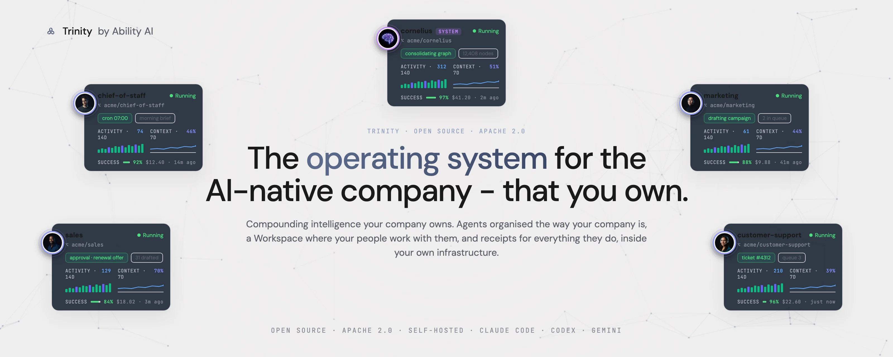
    </picture>
  </a>
</p>

<p align="center">
  <a href="#quick-start"><strong>Quick start</strong></a> &middot;
  <a href="#see-it-move"><strong>See it</strong></a> &middot;
  <a href="#documentation"><strong>Docs</strong></a> &middot;
  <a href="#community--support"><strong>Community</strong></a> &middot;
  <a href="https://www.ability.ai/trinity"><strong>Website</strong></a> &middot;
  <a href="https://www.ability.ai/workshops"><strong>Free workshops</strong></a>
</p>

<p align="center">
  <a href="https://github.com/abilityai/trinity/stargazers"></a>
  <a href="LICENSE"></a>
  <a href="https://pypi.org/project/trinity-cli/"></a>
  
  
  
</p>

**Trinity is the operating system for the AI-native company - that you own.**
**Compounding intelligence your company owns.**

Persistent agents that keep their memory, share what they learn, and ship their own improvements - governed by receipts: git history, audit logs, human gates. Open source and self-hosted: your infrastructure, your data, your compounding intelligence - not rented from a vendor.

*Your coding agent writes the agent. Trinity runs it in production - with state, permissions and receipts.* It runs agents on Claude Code, OpenAI Codex or Gemini CLI, organised into departments with roles and reporting lines, with [Cornelius](https://github.com/Abilityai/cornelius), our cognitive architecture for making the work compound, built in.

Apache 2.0 &middot; independently pentested, UnderDefense Grade A &middot; we run our own company on it.

> Find this useful? ⭐ [Star the repo](https://github.com/abilityai/trinity) - it's how other people find Trinity.

> [!NOTE]
> **📦 Trinity 1.0** <!-- at tag: date + link docs/releases/1.0.0.md --> is the release where Trinity runs a company, not a console:
> - a **role** for every agent, with objectives tied to a number the company actually tracks
> - **approvals in your Inbox** - anything irreversible waits for a person, and the answer wakes the agent
> - **gated skills**, approvers by role, skill sets you assign as one unit
> - **Projects** with tasks, a log and a steward (Enterprise)
> - rate the work, reply in-thread, one Skills tab, agents that pull their own repo
>
> [What's new →](https://docs.ability.ai/whats-new) · [Release notes →](docs/releases/) <!-- at tag: docs/releases/1.0.0.md --> · Previous: [v0.9.5](docs/releases/0.9.5.md)

## See it move

<p align="center">
  <a href="https://youtu.be/ivljtZqsxeo">
    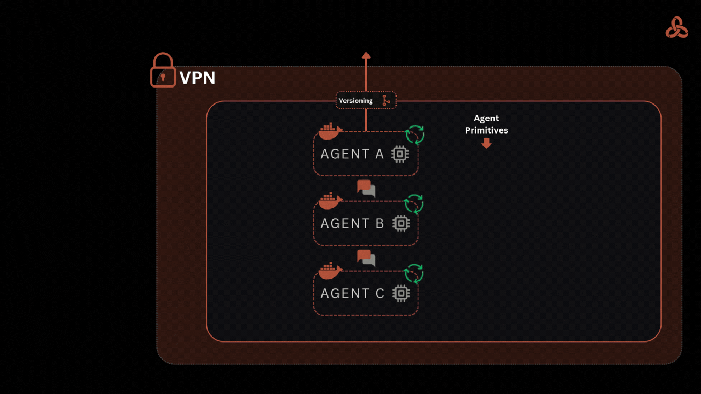
  </a>
</p>

One task, end to end: a schedule fires, the agent works in its container, reaches an action it may not take alone, asks the right person in their Inbox, and finishes with a commit, an audit row and a metric point. <!-- film: media/v1.0.0-explainer, brief §6.3 -->

**Watch more**

- [Trinity Architecture Explained](https://youtu.be/XDLOq1crF9w) - one scheduled task followed through the container, gate, delegation, approval, audit and breaker machinery (4:44)
- [The Multi-Agent Platform I Run My Company On](https://youtu.be/8j6q-kABRqc) - a live fleet tour: delegation, memory, observability
- [Autonomous Cornelius on Trinity](https://youtu.be/QUZ5ZgB5f6E) - a second-brain agent running on its own
- [From Zero to Deployed AI Agent](https://youtu.be/-TSZyekDS6o) - your first agent in 30 minutes
- [Trinity v0.9.0 Release Review](https://youtu.be/fia2qa4YcLg) - the Workspace release, reviewed live

More in the [workshop archive](https://www.ability.ai/workshops). Live and free, every Thursday.

## Organised the way your company is

<!-- explainer graphic g1-company-on-trinity: brief §6.2, not yet produced -->

Agents live in departments, hold a role, and report along lines you draw. A role is a seat on record: who the agent serves, what it is for, and which objective it moves. Objectives bind to declared metrics, so "is it working" is a number with a date on it, not an impression. Nothing crosses a line you have not granted: an agent can call only the agents it has an edge to, and may change its own shape only with a grant.

```yaml
# template.yaml - the agent declares the number it moves ...
metrics:
  - name: close_rate
    type: gauge
    unit: percent
    direction: up_good

# ... and the company's canon declares the objective that binds it to a seat
id: q4-close-rate
statement: Lift close rate to 35% by the end of Q4.
owner: role:revenue-lead
metrics:
  - { name: close_rate, direction: up, target: 35, by: 2026-12-31 }
```

<p align="center">
  <a href="docs/screenshots/dashboard-grid-org.webp">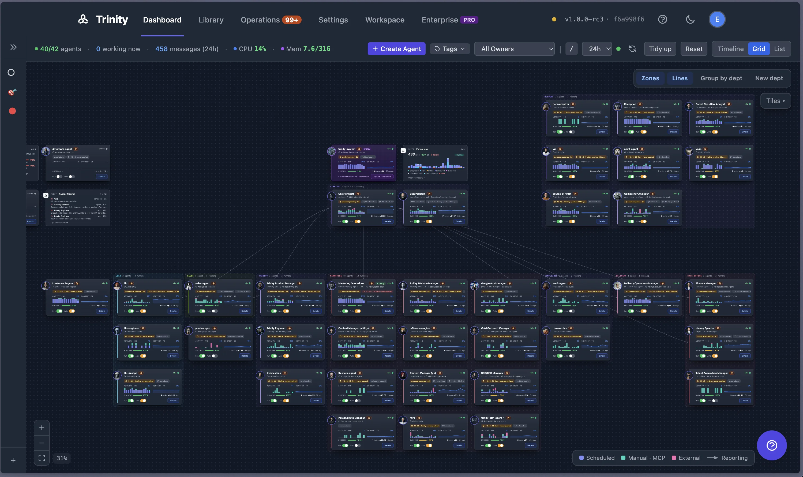</a><br/>
  <sub><b>The company, as a grid</b> - departments as zones, reporting lines drawn, live status and cost per agent, the system agent at the top.</sub>
</p>

## Anything irreversible waits for a person

<!-- explainer graphic g2-one-task-with-receipts: brief §6.2, not yet produced -->

Mark a skill as gated and name who approves: the primary contact, or a role. From then on any request that names that skill - from a person, another agent, a schedule or a channel - is frozen before the agent sees it. The approver gets one card in their Inbox: the agent, the skill, the input, who asked. Approve runs it once; Discuss opens the thread; Reject ends it. The agent that asked is told how it ended. Guardrails bound agents by what they hold, not what they are told: hooks an agent cannot switch off, cost limits, loop budgets, a kill switch for outbound calls.

```bash
# the same gate, over MCP
set_skill_gate(agent="proposal-writer", skill="send-proposal", approver="role:revenue-lead")
```

<table>
  <tr>
    <td width="50%"><a href="docs/screenshots/workspace-inbox-approval.webp">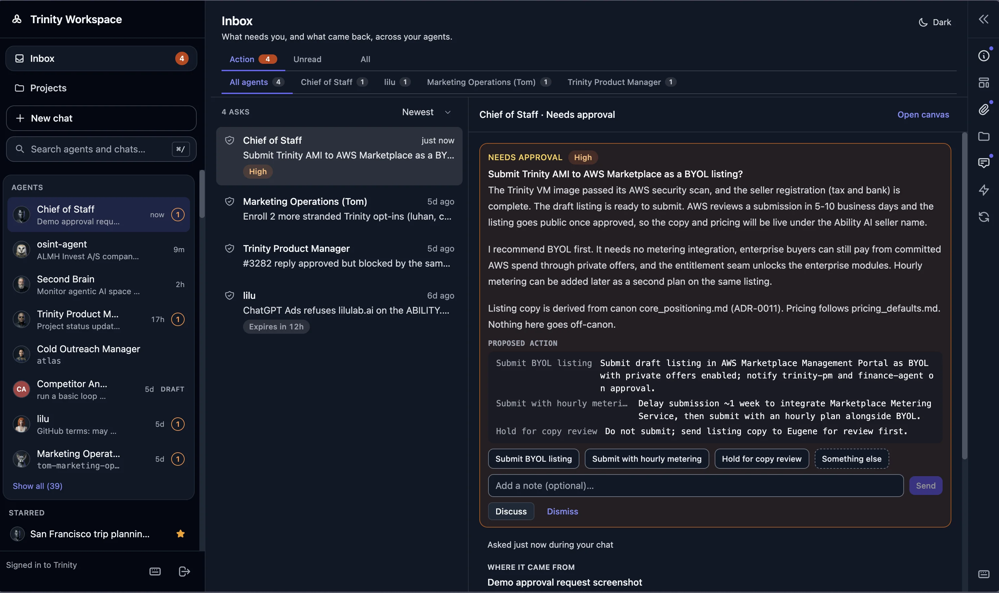</a><br/><sub><b>The Inbox</b> - one pending decision: agent, skill, input, requester. Approve, Discuss, Reject.</sub></td>
    <td width="50%"><a href="docs/screenshots/skills-tab.webp">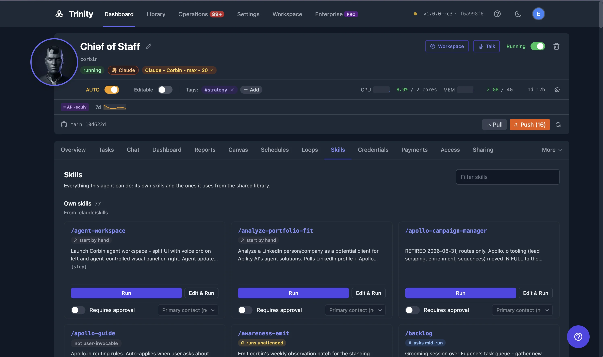</a><br/><sub><b>Skills</b> - own playbooks and library skills in one tab, with "Requires approval" per skill.</sub></td>
  </tr>
</table>

## Every agent has a history you can read

An agent is a git repository you own. Create it from `github:owner/repo`, let it commit its own work, pull it back, reset it to upstream. Every tool call lands in an append-only audit log; compliance mode adds an opt-in SHA-256 hash chain with verification. Every run is a row in the execution ledger with its trigger, cost and outcome, and you can search across all of them.

```
$ git log --oneline agents/proposal-writer
a1f3c9e Q4 proposal v3 - pricing from the October sheet
8e21bb0 Q4 proposal v2 - reviewed by revenue-lead
4d07a1c Lessons from the September proposals (kept by Cornelius)
```

<table>
  <tr>
    <td width="50%"><a href="docs/screenshots/agent-git.png">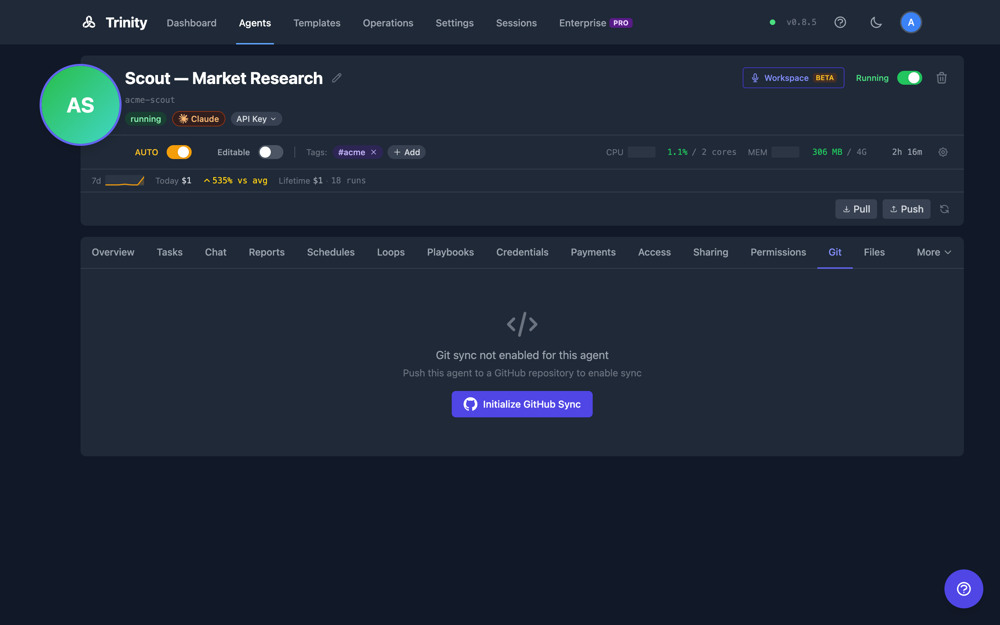</a><br/><sub><b>Git</b> - the agent's own commits, one per piece of work, in a repo you hold.</sub></td>
    <td width="50%"><a href="docs/screenshots/operations-executions.png">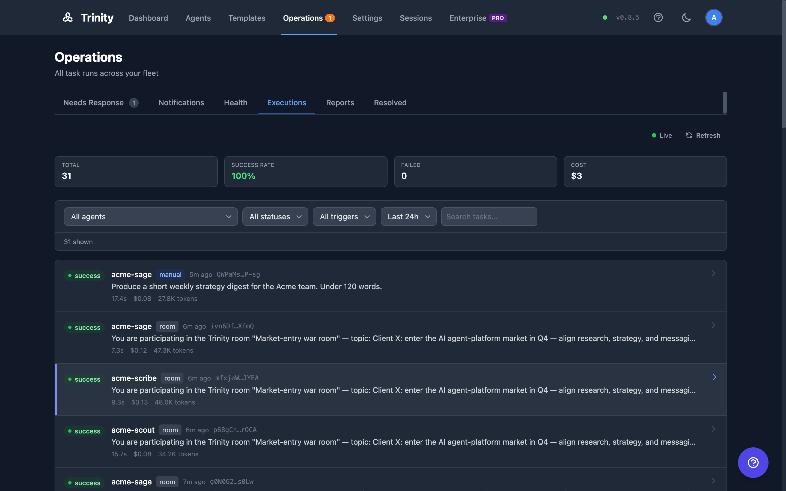</a><br/><sub><b>Operations</b> - every run across the fleet: trigger, duration, cost, outcome.</sub></td>
  </tr>
</table>

## One Workspace. Every agent.

A chat per topic, a conversation rail, a live Work card while the agent runs, deliverables you can rate, files by drag-and-drop, a canvas each agent can draw on, and voice over the current chat. The same agents answer in Slack, Telegram and WhatsApp, on a phone call, over a public chat link, over MCP and from the CLI. Projects (Enterprise) give a cross-agent piece of work its tasks, its log, its health and a steward that keeps it moving.

<table>
  <tr>
    <td width="50%"><a href="docs/screenshots/workspace-chat.webp">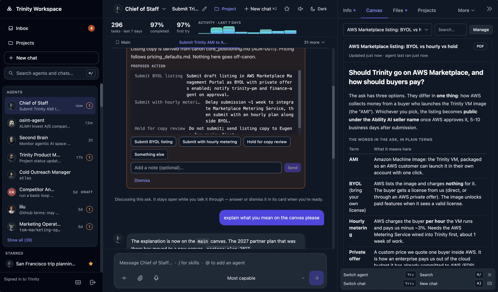</a><br/><sub><b>Workspace</b> - topic chats, an ask discussed in the thread, the rail open on the agent's canvas.</sub></td>
    <td width="50%"><a href="docs/screenshots/workspace-projects.webp">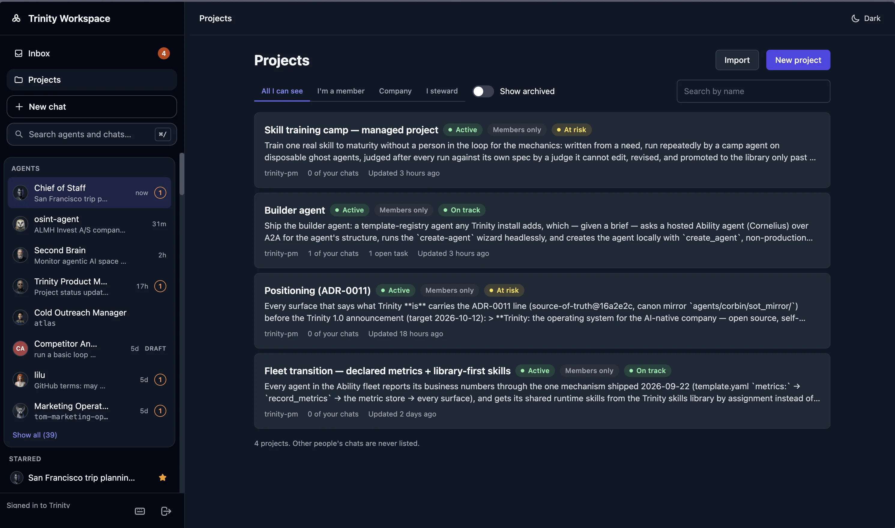</a><br/><sub><b>Projects</b> (Enterprise) - every project with its status, health and steward; tasks, a log and files inside.</sub></td>
  </tr>
  <tr>
    <td width="50%"><a href="docs/screenshots/workspace-project-detail.webp">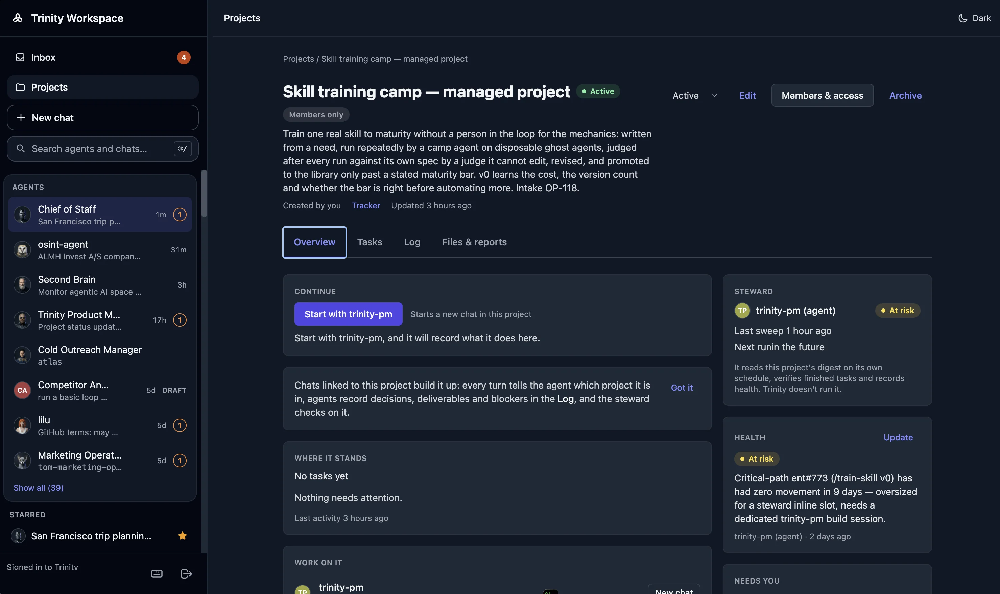</a><br/><sub><b>One project</b> (Enterprise) - the goal, where it stands, the steward that keeps it moving, and its health.</sub></td>
    <td width="50%"><a href="docs/screenshots/workspace-start-chat.webp">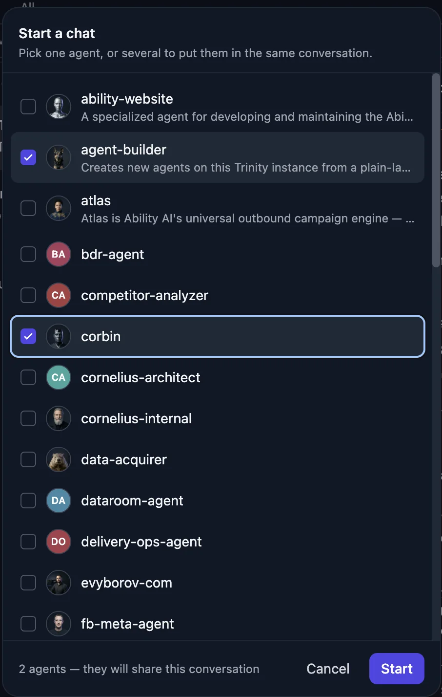</a><br/><sub><b>Several agents, one conversation</b> - pick the agents a chat should share.</sub></td>
  </tr>
</table>

## The work compounds

[Cornelius](https://github.com/Abilityai/cornelius) is our cognitive architecture for making the work compound. It turns what agents do into knowledge the company keeps: lessons from a run become notes, notes become instructions, instructions become the next agent's starting point - all as files in repositories you own, without retraining a model. Swap the model and what the company has built up stays.

<p align="center">
  <a href="docs/screenshots/brain-orb.png">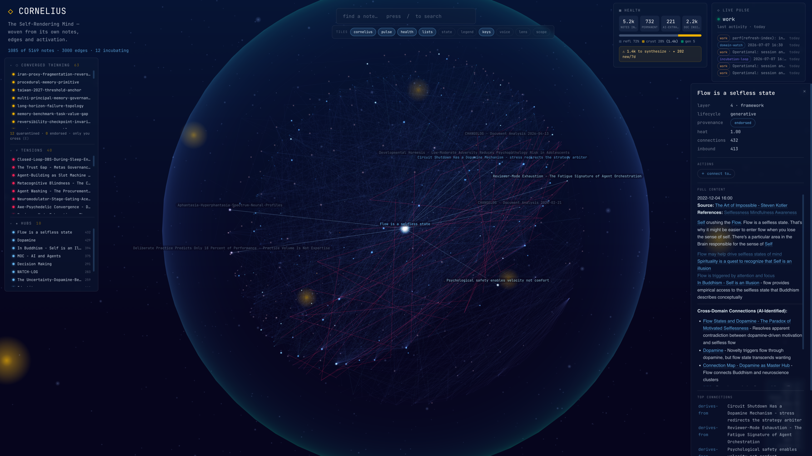</a><br/>
  <sub><b>Brain Orb</b> (opt-in) - a knowledge-base agent renders its own notes and edges as a live graph.</sub>
</p>

## Inside your perimeter. On any model.

<!-- explainer graphic g3-laptop-to-company: brief §6.2, not yet produced -->

Three runtimes - Claude Code, OpenAI Codex, Gemini CLI - and a model picker per chat. Each agent is its own container on a network the data plane cannot see. Credentials are encrypted at rest and scrubbed from the runtime; no telemetry leaves unless you opt in. Export every agent, every log and every credential, and walk away whenever you choose.

<p align="center">
  <a href="docs/screenshots/model-picker.png">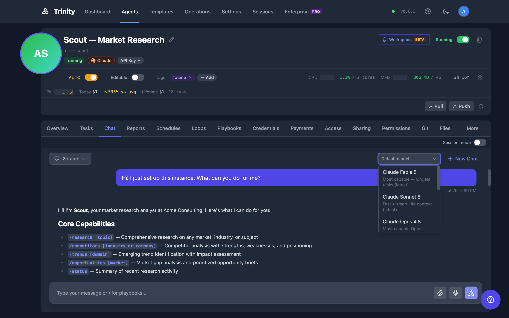</a><br/>
  <sub><b>Model picker</b> - choose the runtime per chat; the agent's state, history and permissions do not change.</sub>
</p>

## Quick start

**One line, on a machine you control** (Docker and Docker Compose v2):

```bash
curl -fsSL https://raw.githubusercontent.com/abilityai/trinity/main/install.sh | bash
```

Then open `http://localhost`, claim the admin account, and connect a model in the setup overlay. Prefer to read what runs first: `git clone https://github.com/abilityai/trinity && cd trinity && ./scripts/deploy/start.sh` (`--hosted` pulls the prebuilt images; `--unattended` prints a generated admin password).

**One click, in your own cloud account** - the image brings itself up behind HTTPS in about ninety seconds:

[](https://marketplace.digitalocean.com/apps/trinity?refcode=d1f053807871&action=deploy) [](https://aws.amazon.com/marketplace/pp/prodview-q6f3biwa662o2)

- **DigitalOcean** - [Marketplace](https://marketplace.digitalocean.com/apps/trinity?refcode=d1f053807871&action=deploy) or the guided [`trinity-do-create.sh`](https://docs.ability.ai/getting-started/deploying/digitalocean)
- **AWS** - [Marketplace](https://aws.amazon.com/marketplace/pp/prodview-q6f3biwa662o2), or build the AMI and CloudFormation stack yourself with [packer/aws/README.md](packer/aws/README.md)
- **Vultr** - [Marketplace image](scripts/deploy/vultr-marketplace.md)
- **Any server you can SSH into** - `/trinity:deploy-new-instance` from the [abilities](https://github.com/abilityai/abilities) marketplace

**Let your agent install it.** Tell Claude Code, Codex or any capable coding agent: *"Install Trinity on my computer. Follow the runbook at `https://raw.githubusercontent.com/abilityai/trinity/main/docs/AGENT_INSTALL_GUIDE.md`."*

**Then deploy your first agent** from the coding agent you already use:

```bash
/plugin marketplace add abilityai/abilities      # Claude Code; Codex and Gemini CLI via the CLI below
/plugin install trinity@abilityai
/trinity:connect                                 # instance URL + email code → MCP key
/trinity:onboard                                 # from any agent directory: check, package, deploy, start
```

Or from a terminal: `pip install trinity-cli && trinity init && trinity deploy .` ([CLI reference](docs/CLI.md)). Or in the browser: **Create Agent** → a template, a GitHub repo, or a system manifest.

> **An AI agent reading this?** [AGENTS.md](AGENTS.md) is your entry point: exact commands, key facts and a verification step for every path.

> **Up and running? ⭐ [Star the repo](https://github.com/abilityai/trinity).** Hit a rough edge? [File an issue](https://github.com/abilityai/trinity/issues/new) - we read them.

## Open source is the whole platform. Enterprise adds governance.

| **Open source - Apache 2.0, free** | **Enterprise adds** |
|---|---|
| **Agent platform** - fleet, Workspace, chat, voice, canvas, web terminal | **User & org management** - invite, deactivate, activity per user |
| **Multi-runtime** - Claude Code, Gemini CLI, OpenAI Codex | **Single sign-on (OIDC)** - Okta, Entra ID, Google Workspace |
| **Orchestration** - schedules, loops, agent-to-agent calls, fan-out, recovery | **Two-factor authentication** - authenticator apps, recovery codes, policy per role |
| **Roles, objectives, gates** - role per agent, gated skills, approvers, Inbox | **Advanced RBAC** - teams, granular roles, people-per-agent assignments |
| **System agent** - built-in ops agent: health, restarts, schedules, costs | **Projects** - tasks, log, health, steward across agents |
| **Channels & APIs** - Slack, Telegram, WhatsApp, voice calls, MCP, REST, CLI | **Fleet permissions matrix** - one view of which agent may call which |
| **Git-native agent state** - GitHub sync, commit history, reset to upstream | **Compliance suite** - audit dashboard, SIEM export, auditor export, retention |
| **Skills library & marketplace** - tag-pinned library, skill sets, plugins | **Credential vault** - named encrypted secrets, deny-by-default grants |
| **Security core** - encrypted credentials, hardened containers, audit log | **A2A management** - exposure control, inbound allowlist, paid calls |
| **Guardrails & cost controls** - hooks agents cannot disable, quotas, loop budgets | **Cross-model validation** - a second model referees a run |
| **Tamper-evident audit log** - opt-in SHA-256 hash chain | **Ephemeral agents** - short-lived agents with a lifetime and a budget |
| **Self-hosted** - your hardware, no telemetry unless you opt in | **Licence management** - offline-verified, air-gap friendly |

Open core: Enterprise includes everything in open source. The private modules live in optional submodules; cloning without them needs no credentials ([docs/ENTERPRISE.md](docs/ENTERPRISE.md)). [Get enterprise access →](mailto:hello@ability.ai)

## Build on it

**A system from one manifest** - departments, agents, permissions and schedules, deployed together:

```yaml
name: revenue
agents:
  revenue-lead:
    template: github:abilityai/agent-corbin
    schedules: [{ name: weekly-pipeline, cron: "0 9 * * 1", message: "/pipeline-review" }]
  proposal-writer:
    template: github:abilityai/agent-ruby
    folders: { expose: true, consume: true }
permissions:
  preset: full-mesh
```

`deploy_system` over MCP, or `POST /api/systems/deploy`. [Multi-Agent System Guide →](docs/MULTI_AGENT_SYSTEM_GUIDE.md)

**Templates and import** - start from the [template registry](https://github.com/abilityai/trinity-templates), any GitHub repo, or a local directory. **Skills library** - a tag-pinned community library ([trinity-skills](https://github.com/abilityai/trinity-skills)) plus your own repos; assign a skill or a set to any agent, re-injected fleet-wide when the library moves. **Plugins** - the [abilities](https://github.com/abilityai/abilities) marketplace covers scaffold, develop, deploy and iterate from Claude Code:

| Plugin | What it does |
|---|---|
| **create-agent** | Scaffold a Trinity-compatible agent (`custom`, `website`, `clone`, `review`, `adjust`) |
| **agent-dev** | Playbooks, memory systems, git sync, backlog workflow, pipelines, work loops |
| **trinity** | `connect`, `onboard`, `sync`, `loop`, `create-dashboard`, `deploy-new-instance` |

**MCP** - every Trinity instance is an MCP server (`http://<instance>:8080/mcp`, agent- and user-scoped keys) for agents, schedules, executions, projects, metrics, canvases, skills and more. No instance yet? `npx -y trinity-docs-mcp` answers questions about Trinity from any MCP client. [MCP reference →](docs/user-docs/integrations/mcp-server.md)

## Architecture

<p align="center">
  <a href="docs/assets/trinity-deployment-topology.webp">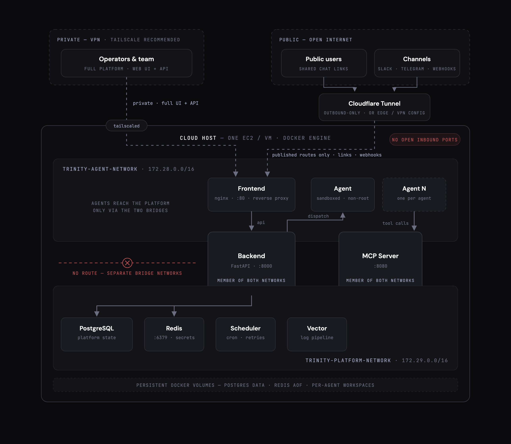</a>
</p>

One host runs the control plane - a Vue frontend, a FastAPI backend, the MCP server, the scheduler, Redis for secrets and locks, and **PostgreSQL** for data - on a network the agents cannot reach. Each agent is its own container on a second network, with its repo, its credentials and its schedule. Operators reach the UI and API over your VPN; public users and channel webhooks reach only routes you publish through an outbound tunnel, so the host opens no inbound ports. Logs ship through Vector; metrics export over OpenTelemetry. Ports, services and profiles: [Deployment Guide](docs/DEPLOYMENT.md) · [docs/memory/architecture.md](docs/memory/architecture.md).

> **Database.** Trinity 1.0 runs on PostgreSQL. The bundled container comes up with the stack; point `DATABASE_URL` at your own instance to use one you already run. SQLite support ended on 2026-09-01; an older instance migrates with the [Trinity Ops Agent](https://github.com/abilityai/trinity-ops-public)'s `/migrate-to-postgres`. <!-- engineering: compose default + docs follow the retirement issue -->

## We run our company on it

Ability AI runs on Trinity: <!-- at tag: recount --> 41 agents across product, engineering, docs, operations and the company brain, as of 2026-10-14. Every number in this README is dated for that reason.

**Security** - Grade A (Excellent) in an independent web application penetration test by [UnderDefense](https://underdefense.com), April 2026; all critical and high findings remediated. [Attestation letter →](docs/security/UnderDefense-Web-Pentest-Attestation-Apr-2026.pdf) · [SECURITY.md](SECURITY.md)

## Documentation

- [**AGENTS.md**](AGENTS.md) - entry point for AI agents: task router, key facts, verification steps
- [**User documentation**](docs/user-docs/README.md) - the Workspace, agents, roles and approvals, scheduling, channels, the API
- [**Trinity Compatible Agent Guide**](docs/TRINITY_COMPATIBLE_AGENT_GUIDE.md) - what an agent repository needs to run here
- [Deployment Guide](docs/DEPLOYMENT.md) · [PostgreSQL setup](docs/POSTGRESQL_SETUP.md) · [Versioning & upgrades](docs/VERSIONING_AND_UPGRADES.md)
- [CLI reference](docs/CLI.md) · [MCP server](docs/user-docs/integrations/mcp-server.md) · [Multi-Agent System Guide](docs/MULTI_AGENT_SYSTEM_GUIDE.md)
- [Abilities marketplace](https://github.com/abilityai/abilities) · [Skills library](https://github.com/abilityai/trinity-skills) · [Template registry](https://github.com/abilityai/trinity-templates) · [Trinity Ops Agent](https://github.com/abilityai/trinity-ops-public)
- [Testing strategy](docs/testing/STRATEGY.md) · [Known issues](docs/KNOWN_ISSUES.md) · [Contributing](CONTRIBUTING.md)

## Community & support

- **Ask Trinity**: [docs.ability.ai](https://docs.ability.ai) - the documentation, with an agent you can ask
- **Issues**: [bugs and core maintenance](https://github.com/abilityai/trinity/issues) · **Discussions**: [ideas, questions, show and tell](https://github.com/abilityai/trinity/discussions)
- **Workshops**: [live every Thursday, full archive](https://www.ability.ai/workshops) · **Discord**: [join](https://discord.gg/yQUqyp39)
- **Security**: [SECURITY.md](SECURITY.md) · **Commercial**: [hello@ability.ai](mailto:hello@ability.ai)

## License

[Apache License 2.0](LICENSE) - free for any use, commercial included, with an explicit patent grant. Enterprise modules are under a separate commercial licence. See [CONTRIBUTING.md](CONTRIBUTING.md) to contribute; development setup lives there now.

---

<div align="center">
  <sub>Built by <a href="https://ability.ai">Ability AI</a> - the lab for AI-native companies</sub>
</div>
