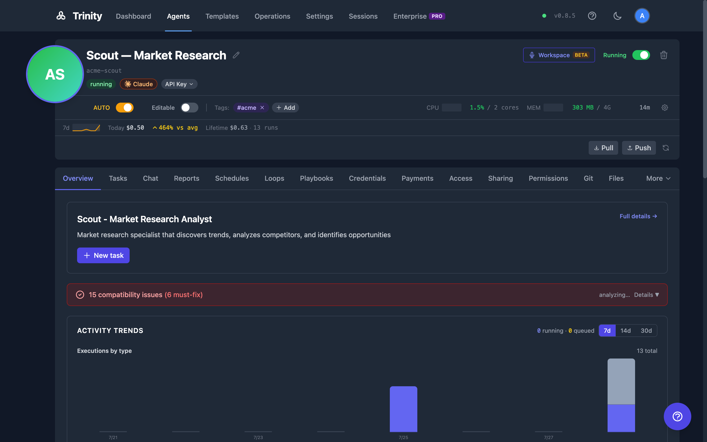

# Managing Agents

Control the lifecycle, health, and resources of your Trinity agents through the UI, API, or MCP tools.

## How It Works

### The Agent Detail Page

Click any agent to open its detail page. The page lands on the **Overview** tab and organizes everything else into tabs:

| Tab | `?tab=` | Purpose |
|-----|---------|---------|
| **Overview** | `overview` | Default landing tab — trends, health, recent activity (see below) |
| **Tasks** | `tasks` | Headless task execution and history |
| **Chat** | `chat` | Stateless conversation -- see [Agent Chat](agent-chat.md) |
| **Dashboard** | `dashboard` | The agent's own dashboard — only when it ships a `dashboard.yaml` |
| **Brain** | `brain` | Knowledge-graph page — only for agents that declare the capability |
| **Reports** | `reports` | Structured results the agent published -- see [Agent Reports](../operations/agent-reports.md) |
| **Canvas** | `canvas` | The surface the agent keeps current -- see [Agent Canvas](agent-canvas.md) |
| **Schedules** | `schedules` | Cron-based automation -- see [Scheduling](../automation/scheduling.md) |
| **Loops** | `loops` | Sequential bounded task runs -- see [Agent Loops](../automation/agent-loops.md) |
| **Skills** | `skills` | The agent's own skills and those shared from the library, each with **Run**; owners also set approval and assign skills -- see [Skills](../automation/skills-and-playbooks.md) |
| **Payments** | `nevermined` | Paid access configuration |
| **Sharing** | `sharing` | External clients and channels (owners only) |
| **Permissions** | `permissions` | Which agents may call this one (owners only) |
| **A2A** | `a2a` | External-orchestrator interoperability (owners only, where available) |
| **Git** | `git` | Git status, pending changes, recent commits, **Pull**, **Push** and **Refresh** — only for GitHub-synced agents |
| **Files** | `files` | Workspace file browser |
| **Settings** | `settings` | The one configuration home (owners only), pinned last on the strip: a rail of panes — **General**, **Guardrails**, **People**, **Channels**, **Integrations**, **Storage** — with the pane in `?section=`. See [Agent Configuration](agent-configuration.md#the-settings-home) |

Tabs marked *owners only* are hidden from users an agent is merely shared with. The system agent shows none of them except **Settings**, where it gets the General (read-only), Guardrails and Integrations panes. **Dashboard**, **Brain**, **Git**, and **A2A** appear only when that agent or instance supports them.

The Info, Credentials, Access and Folders tabs no longer exist. Template details are under **Settings › General**, credentials and shared folders under **Settings › Storage**, and the access roster under **Settings › People**.

Every visible tab is deep-linkable with `?tab=` — including the conditional ones. The URL follows the tab you pick, so a reload keeps you on that tab, you can copy the address to link to it, and the browser's Back button steps back through the tabs you visited before it leaves the page. Returning to an agent page through a link that names no tab (from the Dashboard, say) keeps the tab you were on, as long as that agent has it. A `?tab=` value naming a tab you cannot see falls back to Overview, and the address is corrected to match.

Inside Settings the pane is in the URL too: `?tab=settings&section=general|guardrails|people|channels|integrations|storage`. A bare `?tab=settings` opens General, a `section` naming a pane you cannot see lands on the first pane you can, and Back steps between the panes you visited. Legacy links still resolve: `?tab=info` opens **Settings › General**, `?tab=guardrails` opens **Settings › Guardrails**, `?tab=credentials` and `?tab=folders` open **Settings › Storage**, `?tab=access` opens **Settings › People**, `?tab=playbooks` opens **Skills**, and `?tab=session` redirects to that agent's [Workspace](../sharing-and-access/workspace.md) conversation.

When the window is too narrow to fit every tab, the trailing tabs collapse into a **More ▾** menu at the end of the tab strip. **Settings** sits outside that menu, pinned at the end of the strip, so it is always one click away. If the active tab is inside the menu, the More button carries the active highlight. Deep links via `?tab=` work either way.

### Overview Tab

The Overview tab is a glanceable, database-backed summary. It renders even when the agent is stopped:

- **About** -- display name, tagline, and description, with a "New task" shortcut.
- **Needs attention** -- a combined count of pending notifications, operator-queue items, and sync failures, linking to the [Operations page](../operations/operating-room.md). Hidden when the count is zero.
- **Activity trends** -- executions per day (stacked by trigger type), success rate, duration (avg and p95), and context consumption over a selectable 7/14/30-day window. Trigger types are bucketed as Chat/Tasks, MCP, Channels, Public, Scheduled, Loops, Agent-to-agent, Voice, and Other.
- **Health & reliability** -- current health badge, reachability, restart count, plus uptime and latency trend lines. Health history covers at most the last 7 days; if fleet monitoring has never run, the panel shows "No health data available -- the monitoring service may be off."
- **Recent activity** -- the last five executions; click one to open it in the Tasks tab.
- **Footprint** -- schedule, skill, and share counts, plus git sync status.

A **live strip** at the bottom of the agent header shows the present: for a running agent, CPU and memory against their limits (with sparklines) and uptime; for a stopped one, when it was created and the CPU and memory allocated to it. Once the agent has run anything, a second line shows spend — today, a 7-day sparkline and trend, and lifetime cost and run count (API-price equivalents for a subscription-funded agent). Nothing in the strip is a control; the limits and funding are set under **Settings › General**.

The persistent header above the tabs holds the agent's identity (avatar, name, id, description), its running state and badges, the **Autonomy** chip and the Start/Stop switch. As an owner you can edit the identity right there: the pencil beside the name edits the display name in place (Enter saves, Esc cancels, leave it empty to show the id), and hovering the avatar offers **Generate an avatar** when there is none, or **Change avatar prompt** and **Next emotion** when there is one. The same rows live under **Settings › General › Identity**, which is also the only place to rename the agent's id. Below the name the header shows:

- **Repository** — when the agent is bound to a GitHub repository and running, the repo (a link to GitHub), the current branch, and how many changes are waiting to be pushed or pulled. Pull and Push are on the **Git** tab.
- **Tags** — the first two tags, with a "+N" count for the rest. Owners click the pencil (or **Add tag**) to add and remove tags; the same editor is in **Settings › General**.
- **Context** — for a running agent, a small ring showing how full its context window is. It reads "—" until there is a reading.

To work with the agent in the [Workspace](../sharing-and-access/workspace.md) or start a voice call, open the Workspace from the navigation bar — see [Voice Chat](../advanced/voice-chat.md).

- **API:** `GET /api/agents/{name}/analytics?window=7d|14d|30d`

### Start and Stop

Toggle an agent between Running and Stopped using the switch on a Dashboard tile or list row, or in the Agent Detail header. A loading spinner displays during state transitions.

- **API:** `POST /api/agents/{name}/start` and `POST /api/agents/{name}/stop`
- **MCP:** `start_agent(name)` and `stop_agent(name)`

A start also delivers the agent's assigned skills, and the start response says how that went. `skills_injection` is the overall status, and `skills_result` lists each skill's status plus any name `conflicts`, with errors reduced to a code. A start that did nothing reports `skipped` with a reason; a missing result reads `unknown`. A conflict does not fail the start, so check `conflicts` to tell it apart from a clean one. The MCP `start_agent` tool adds a line for each skill that did not land.

**After a host reboot.** Agent containers are created with Docker's `unless-stopped` restart policy, so when the host reboots or the Docker daemon restarts, every agent that was running comes back on its own — schedules resume without anyone starting agents by hand. An agent you deliberately stopped stays stopped: the policy honours Docker's manual-stop flag, so a quarantined agent is never resurrected by a reboot. While Docker is bringing agents back they may briefly show as stopped. The policy is set when the container is created; agents created before this behaviour shipped adopt it on their next recreate (a resource, runtime, or base-image change), not on a plain restart — an upgrading install can sweep its existing fleet once using [`AGENT_RESTART_POLICY_2026-09.md`](../../migrations/AGENT_RESTART_POLICY_2026-09.md).

### Display Label

The **display label** is the friendly name shown across the UI — the header, agent pickers, search, sort, and the activity timeline. Editing it is the everyday "rename": it changes what people read without moving the immutable slug (`name`), so it never breaks URLs, MCP tool names, schedules, or webhooks. For most day-to-day relabeling, this is the change you want; the heavier [Rename](#rename) below moves the slug itself.

- Edit it from the pencil beside the name in the agent header, or from **Settings › General › Identity › Display name**.
- Owner-only. The label is non-unique (the slug guarantees uniqueness) and clears back to the slug when left blank.
- Input is trimmed; control characters and line breaks are rejected with a named error.
- There is no MCP tool for the display label — it is a UI/API-only, presentation-only change. (The MCP `rename_agent` tool moves the slug, not the label.)

- **API:** `GET /api/agents/{name}/label` and `PUT /api/agents/{name}/label` with body `{"label": "My Agent"}` (send `{"label": null}` or an empty string to clear back to the slug)

### Rename

Renaming moves the immutable slug itself — the heavier operation. Because the slug is what URLs, MCP tool names, schedules, and webhooks resolve to, prefer the [Display Label](#display-label) above when you only need to change the friendly name.

Open **Settings › General › Identity › Agent id** and click **Rename…**. The editor warns that the rename stops and restarts the agent, re-keys its URLs and MCP keys, and leaves its data volumes under the old id; **Rename id** confirms. (To change only the name people see, edit the **Display name** row above it.) Renaming is atomic: it updates the database, renames the Docker container, and broadcasts the change via WebSocket.

Restrictions: system agents cannot be renamed. Only owners and admins have permission to rename.

- **API:** `PUT /api/agents/{name}/rename` with body `{"new_name": "new-name"}`
- **MCP:** `rename_agent(name, new_name)`

### Delete

Open **Settings › General › Danger zone** and click **Delete…**. A confirmation dialog is required. The row appears only for agents you may delete; there is no delete button in the header.

Deletion is a soft delete. The container is stopped and removed at once, and the agent's schedules stop firing. Its workspace volumes, schedules, chat history, sharing records, permissions and credentials are kept until a retention sweep purges them (`agent_soft_delete_retention_days`, default 180 days). Until then the name stays reserved, and an admin can recover the agent with `POST /api/admin/soft-deleted/agents/{name}/recover` (list them with `GET /api/admin/soft-deleted/agents`). Recovery restores the record but not the container, so start the agent afterwards.

Volume clean-up stays inside this Trinity installation. Each agent volume carries the installation's id, so when two Trinity stacks share one Docker daemon, neither the purge nor the sweep for orphaned agent volumes touches the other stack's volumes. The orphan sweep never reclaims a volume created before that label existed; unattached ones of those are named in a warning in the backend log for a person to review.

- **API:** `DELETE /api/agents/{name}`
- **MCP:** `delete_agent(name)`

### Health and Status

The agent header displays status (Running/Stopped). CPU and memory usage and uptime are in the live strip at the top of the **Overview** tab; telemetry auto-refreshes every 10 seconds.

Fleet-wide health for the agents you can access is at `GET /api/monitoring/status`; one agent's is at `GET /api/monitoring/agents/{name}`. Admins also have `GET /api/ops/fleet/health` — see [Monitoring](../operations/monitoring.md). Health levels, from best to worst: healthy, degraded, unhealthy, critical, unknown.

- **MCP:** `get_agent_health(name)`, `get_fleet_health()` (includes each agent's git `sync` block), `get_fleet_sync_audit()`, `trigger_health_check()`

### Resource Allocation

Configure per-agent memory and CPU limits under **Settings › General › Execution › Memory and CPU**. Limits are enforced at the container level; a change is saved at once and applied on the next restart, which the bar at the top of Settings offers. A CPU limit above the host's CPU count is capped to that count -- see [Agent Configuration](agent-configuration.md#resource-allocation) for valid values and fleet-wide defaults.

Execution timeout is configurable per agent under **Settings › General › Execution › Execution timeout**, in whole minutes from 1 to 120 (default 60); the API takes seconds (range: 60--7200, default: 3600).

The agent's timeout is the ceiling for any of its schedules — setting it below an active schedule's `timeout_seconds` is rejected with `400 error=agent_timeout_below_active_schedules`.

- **API:** `GET /api/agents/{name}/timeout` and `PUT /api/agents/{name}/timeout`

### Listing

The Dashboard lists the fleet in three modes — **Timeline**, **Grid**, and **List** (press `v` to cycle them). List mode is the row view with success-rate bars; filter by name, status, or tags. The old `/agents` page redirects to the Dashboard's List mode. See [Dashboard](../operations/dashboard.md).

- **API:** `GET /api/agents` returns all agents
- **MCP:** `list_agents()`

## For Agents

Agents can manage other agents programmatically through the MCP tools listed above. Common patterns include orchestrator agents that start and stop worker agents on demand, or monitoring agents that poll fleet health and trigger alerts when agents become degraded or unhealthy.

## See Also

- [Creating Agents](creating-agents.md)
- [Agent Configuration](agent-configuration.md)
- [Scheduling](../automation/scheduling.md)
- [Agent Loops](../automation/agent-loops.md)
- [Agent Network](../collaboration/agent-network.md)
