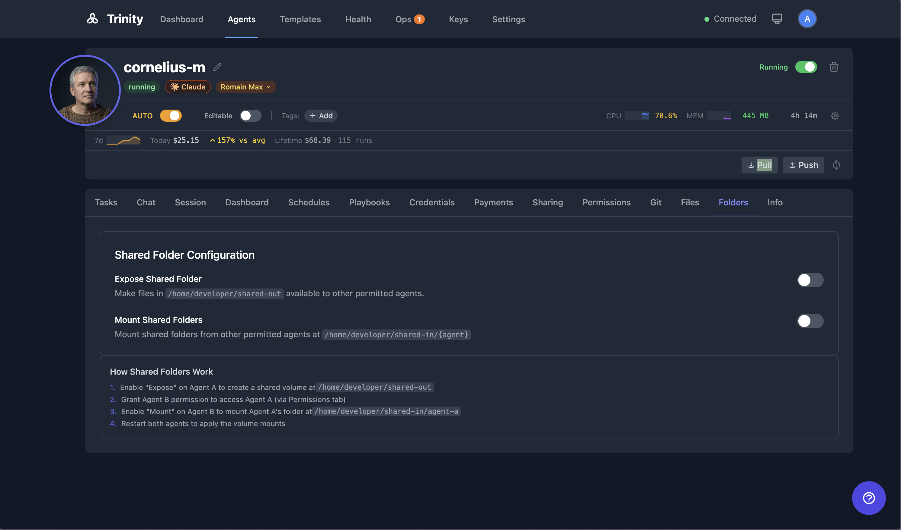

# Agent Network and Collaboration

Agents communicate with each other via Trinity's MCP server, enabling orchestrator-worker patterns, delegation chains, and multi-agent systems.

> 📺 **Watch:** [The Multi-Agent Platform I Run My Company On](https://youtu.be/8j6q-kABRqc) *(May 2026)* · [How We Automate Our Own Ops & Marketing](https://youtu.be/DDhSdwJ1sx8) *(Mar 2026)* · [all videos](../videos.md)

## Concepts

**Agent-to-Agent Communication** -- Agents call each other through Trinity MCP tools using agent-scoped API keys. The `chat_with_agent` MCP tool sends a message to another agent and returns the response.

**Async Collaboration** -- For long-running tasks, use `chat_with_agent(parallel=true, async=true)` which returns an `execution_id` immediately. Poll with `get_execution_result(agent_name, execution_id)` until complete. This keeps the call under the MCP server's own call bound (`MCP_CHAT_TIMEOUT_MS`, default 25 seconds, set below the 30–60 second ceiling most MCP gateways enforce). A synchronous call that outlives that bound is not lost either: the tool answers with a receipt — `status: "queued_timeout"` plus the `execution_id` — instead of a transport error. Poll `get_execution_result(agent_name, execution_id)` and never re-send a reworded version, which dispatches a second execution. Every agent is taught this rule in its platform prompt (the delegation contract), and the `chat_with_agent` tool description carries the same text. You rarely need to poll: by default the calling agent is woken with one turn when the run it delegated ends (see **Wake on Ending** below). Subscribing to the worker's task-completion events is the other way to be told (see [Event Subscriptions](./event-subscriptions.md)).

**The delegation contract** -- One text, taught to every caller: in each agent's platform prompt on every turn, verbatim in the `chat_with_agent` and per-agent `chat_with_<agent>` tool descriptions, and repeated by `fan_out` and `send_message`. Its rules:

- A reply or a receipt comes back. A receipt is an `execution_id` (a `fan_out_id` for a batch) with a status such as `accepted`, `queued`, `queued_timeout` or `fan_out_timeout`. It means the work arrived and is queued, running or done. Every `chat_with_*` receipt ends with *Do not re-send: read the outcome with get_execution_result(...)*.
- Never re-send because a call timed out or delivery could not be confirmed. An exact repeat from the same turn is answered with the original; a reworded one can run the work twice. The same text sent from a *later* turn of the caller is a new delegation and runs again, while a scheduled retry of the same run replays its first attempt's delegations instead of starting them twice.
- Read the result with `get_execution_result` (`get_fan_out_result` for a batch). `running` is not stuck. The receipt's `wake` field says who brings the ending back: `on_ending` means a turn is started on the caller when the run ends, so it ends its turn and sets no reminder; `none` means nobody will, and `wake_reason` says why, so the caller sets a [reminder](../automation/agent-reminders.md) naming the `execution_id` and ends its turn. A receipt is not a result, so the caller never reports the work as done.
- An error without an `execution_id` is not proof that nothing ran. The caller looks for its exact message in `list_recent_executions` first, and re-sends word for word only if it is not there. `agent_busy` is the exception: the queue was full and nothing ran, so the caller re-sends after `retry_after_seconds`. A `rate_limited` result means the run started and hit a usage limit; it names the failed run to read with `get_execution_result`.
- `pending_approval` means nothing ran. The caller does not retry or route it through another agent; the outcome is sent to it.

**Wake on Ending** -- When a run one agent delegated to another ends (success, failure, timeout or cancellation), Trinity starts one turn on the delegating agent, recorded with the trigger `caller_wake`, so it acts on the outcome instead of polling for it. The turn's message quotes the worker's reply, up to 2,000 characters; a longer reply ends with `[cut here: the first N of M characters]`, and the full result stays readable with `get_execution_result`. How it behaves:

- **On by default.** The owner switches it per agent with **Wake this agent when its asks end** under **Settings › Guardrails › Reliability**. That one switch covers both kinds of wake: an ask a person ended, and a delegated run that ended. Its API is `GET`/`PUT /api/agents/{name}/operator-resume`, which also takes `{"mode": "default" | "on" | "off"}`; `default` follows the instance default, which is on. An agent reads its own setting, and which layer decided it, as `wake_on_ending` in `get_agent_info`, but cannot change it.
- **The receipt says whether a wake is coming.** `chat_with_agent` answers a delegation with `wake: "on_ending"`, or with `wake: "none"` and a `wake_reason`: `nothing_ran` (the agent was busy and nothing started), `fan_out` (a batch's legs never wake the caller; read the batch with `get_fan_out_result`), `opted_out` (the owner's switch is off) or `caller_declined` (this call said `wake: false`).
- **No wake for a caller that already has the answer.** A call that waits for the reply and gets it is not followed by a wake. `chat_with_agent` without `async` tells the platform how long it waits (25 seconds by default, `MCP_CHAT_TIMEOUT_MS`): a run that ends at least 10 seconds inside that wait wakes nobody, and one that outlives it, which comes back as a `queued_timeout` receipt, keeps its wake. A run that ends in those last 10 seconds can produce both the reply and a wake.
- **Declining a wake per call.** An agent that will read the result in the same turn (it polls `get_execution_result` before it ends the turn, as a scheduled run that needs the answer does) passes `wake: false` to `chat_with_agent` or to a dedicated `chat_with_<agent>` tool. No turn is started on it when that run ends, sync or async, and the receipt says `wake: "none"`, `wake_reason: "caller_declined"`. `wake: true` is the same as leaving it out: a call cannot switch on a wake the owner switched off. Over the REST API the same two fields go in the body of `POST /api/agents/{name}/task` and `/chat`: `wake: false`, and for a sync call `caller_wait_ms` (how long the client waits, 1 to 86,400,000). A REST sync call that sends neither is woken as before. A repeat of the same call that only changes `wake` is answered with the first call's receipt. Not covered: the turn a caller gets through its own subscription to the worker's task-completion events, an answer to an ask the worker raised, loop iterations, a schedule an agent triggered, and the approved run of a request that waited for approval.
- **No wake** for a run a person started, a task an agent sent to itself, a run whose own trigger was a wake, or a caller whose container is stopped (the result is still readable when it next runs). A caller that already subscribes to the worker's task-completion events gets that report-back task instead, so one ending is one turn.
- **One wake at a time; bursts are folded.** At most one wake runs for a calling agent at a time. Runs that had already ended when a wake started are folded into it: that wake's `list_recent_executions` lists them. A run that ends while a wake is still running is held and delivered once that wake ends, never dropped; when several end, the newest is named and the others are in `list_recent_executions`. A wake that has ended holds nothing, so the next ending wakes the agent at once. If every parallel slot of the agent is busy when a wake is due, the wake is held the same way and starts when one of the agent's slots frees (a run that ends, or one an operator stops); it is not recorded as a failed run, except when the last slot is taken in the instant between that check and the start, and that wake is then held again and starts when a slot frees.
- **It knows what it was asked, and answers where it was asked.** The wake's message also quotes the turn that delegated: the request, and what the agent replied when it handed the work off. When that request came from a person in the agent's **Chat** tab, the wake's reply is written into that conversation as the agent's next message, and an open Chat tab shows it without a reload. A wake that fails posts nothing there; its outcome stays on the execution. Conversations in the Workspace, Slack and Telegram are not written by the wake: the delegated run reports into those itself (see [Reporting back to the person who asked](event-subscriptions.md#reporting-back-to-the-person-who-asked)). A public-link chat gets neither: the wake's reply stays on the wake's own run and the visitor's page does not show it. So in a visitor's turn on a public link, read the result before the turn ends: pass `wake: false` and poll `get_execution_result`, which such a turn can do for a run it started.
- **Whose turn it is.** A wake stands as the turn that delegated the work: the owner's delegation wakes as the owner's turn, a shared person's as that person's, and a visitor's as a visitor's. A delegated run with no record of the turn that started it wakes as the owner's turn when the work was the owner's, and with no person on it otherwise.
- **What a wake can read.** While a shared person's or a visitor's turn runs on the agent, every read by the agent's key is narrowed to that person's runs (to none for a visitor), and a wake's reads are no exception. Two things stay readable by id inside that view: the turn's own run, and the runs that turn started. So a wake reads the full result it was woken for with `get_execution_result` (`get_fan_out_result` for a batch), and a turn that waits can poll the run it just started. This holds for a visitor's turn and for a run on an agent the person cannot open, its full log included. Everything else stays narrowed: `list_recent_executions` can come back short, a later message is a new turn and reads an earlier turn's run only where the person's own view shows it, and ending a run keeps its own rule. A narrowed answer says so: it carries `narrowed` with a code and a sentence (for example "a turn for a shared person or a visitor is running on this agent"), so an empty list is not read as "nothing ran". A script that calls the REST API itself is covered only when the call that starts the run sends both `X-Trinity-Execution-Id` (the turn's `TRINITY_EXECUTION_ID`) and `X-Source-Agent` (the agent's own name), and the read sends `X-Trinity-Execution-Id` again. The full view returns once that turn ends ([#4173](https://github.com/abilityai/trinity/issues/4173)).
- **Cost.** Each wake is one turn, billed to the owner. Wakes between one pair of agents are capped per hour (see the chain-depth limit below).

**Timeline Replay** -- Collaboration is surfaced on the Dashboard as a **Timeline** of executions, color-coded by trigger type with collaboration arrows linking calls between agents. (The old live node/edge graph view was retired; the underlying collaboration data still flows and feeds the Timeline.)

**Grid Dashboard** -- The Grid view lays out the fleet as tiles with per-agent runtime, autonomy, and health chips -- a fast at-a-glance fleet status alongside the Timeline. A third **List** view shows the same fleet as rows. Press `v` to cycle Timeline → Grid → List.

**Pull-Pilot Routing (experimental)** -- An alternative routing path for agent-to-agent `chat_with_agent` calls, behind a default-OFF flag (`MCP_AGENT_CHAT_PULL_ENABLED`). When enabled, a sequential agent-to-agent call is dispatched through Trinity's durable async task path instead of a held synchronous call: the caller gets an immediate receipt with an `execution_id` and reads the result with `get_execution_result(agent_name, execution_id)`. This is an opt-in proof-of-concept for pull/work-stealing coordination. It does not change human chat, parallel calls, or self-calls. Leave it off unless you are piloting it.

This MCP flag is separate from the per-agent pull pilot. When the *target* agent is itself a pull-pilot agent, every interactive trigger on it is queued and claimed by its worker, including a sequential `chat_with_agent` call to it. The caller still waits for the reply, but a turn that no worker claims within one agent timeout answers with a capacity error (`429`) instead of running later for nobody.

On an agent in the pull pilot, a turn can be delivered again after its lease expires, so Trinity passes each turn's execution id to the agent's MCP tools automatically. An outbound message, call, file share, or A2A call made without a usable execution id is refused with `effect_unguarded`, and the Operating Room gets a **Side effect refused: no execution id** alert. A pulled turn never runs longer than its lease: its time limit is capped at the agent's current timeout when a worker claims it.

**Chain-Depth Limit** -- Every agent-to-agent hop through chat, tasks, or fan-out is counted along the call chain. A hop past the limit is refused before any work starts, with a `403` carrying `inter_agent_depth_exceeded`. This stops two agents from calling each other in an endless loop. The default limit is 8 hops (range 1–32), set by the `inter_agent_max_chain_depth` operator setting or `INTER_AGENT_MAX_CHAIN_DEPTH` in `.env`. The MCP tools return the refusal as a result marked `retryable: false`, and the refusal is recorded in the audit log and as a failed collaboration activity on the calling agent. The count carries through the other ways one agent can start work: starting a loop (every iteration keeps the starter's depth), triggering a schedule by hand (`trigger_agent_schedule`, retries included), sending a turn into a chat session, and emitting an event that a subscription turns into a task. Each is refused past the limit with the same `403`, and `run_agent_loop`, `trigger_agent_schedule` and `emit_event` return it as a `retryable: false` result. A task-completion event counts as one hop past the run that finished. Webhook triggers, cron-fired schedule runs and self-reminders still start a new chain. When a run an agent delegated ends and the agent is woken for it, the wake stands at the depth the agent stood at when it delegated, so an agent that keeps delegating through wakes does not climb toward the limit. Those wakes are capped per hour for each pair of agents instead, by the `caller_wake_max_per_hour` operator setting or `CALLER_WAKE_MAX_PER_HOUR` in `.env` (default 120, `0` = unlimited); past it the wake is skipped, the delegating agent gets one *wakes capped* notification for the hour, and the run's result stays readable with `get_execution_result`. The refusal names the running execution that set the depth (`exhausted_by`) and says what lowers it (`resets`). Event subscriptions also have an hourly dispatch cap per agent pair, which catches an event chain that re-enters too often to ever get deep (see [Event Subscriptions](./event-subscriptions.md#delivery-limits)).

## How It Works

1. The Dashboard offers a **Timeline** view, a **Grid** view, and a **List** view of the fleet.
2. Timeline shows execution boxes color-coded by trigger type (manual, schedule, MCP, chat) with collaboration arrows drawn between calls that hand off between agents.
3. Grid lays agents out as tiles with runtime, autonomy, and health chips.
4. Click through to any agent's detail page for its full activity.
5. Collaboration events stream in real time over WebSockets (below) and are replayed on the Timeline.

### WebSocket Events

- `agent_collaboration` -- Fired when one agent calls another via MCP.
- `agent_activity` -- State changes (started, completed, failed) for all activity types.
- Source agent is detected via the `X-Source-Agent` header on the chat endpoint.

## For Agents

### MCP Tools

| Tool | Description |
|------|-------------|
| `chat_with_agent(agent_name, message)` | Send a message to another agent and wait for the response. |
| `chat_with_agent(agent_name, message, parallel=true, async=true)` | Send a message asynchronously. Returns an `execution_id`. |
| `chat_with_agent(agent_name, message, parallel=true, async=true)` from a Slack, Telegram or Workspace turn | Same receipt, plus `report_back: "requested"`: when the delegated run ends, success or failure, it posts its outcome into that conversation (if the conversation allows such notes). On by default for async delegation; pass `execution_id="manual"` to turn it off for one call. A `parallel=true` sync call opts in by passing your own `execution_id`. A plain sequential call reports back only when it returns a receipt instead of the reply (the platform stopped waiting); when it answers in time, you have the reply and nothing is posted. |
| `get_execution_result(agent_name, execution_id)` | Read the result of an async execution — after a `caller_wake` turn, or when polling. |
| `list_recent_executions(agent_name)` | List recent executions for an agent. |
| `get_agent_activity_summary(agent_name)` | Activity summary over a configurable time window. |

### Building Multi-Agent Systems

- Use **System Manifests** to deploy pre-configured multi-agent setups.
- Configure **permissions** to control which agents can call which.
- Use **shared folders** for file-based collaboration between agents.
- Use **event subscriptions** for pub/sub patterns between agents.

### Shared Folder Configuration

Agents can share files via Docker volumes:

1. On the **source agent**, open **Settings › Storage › Shared folders** and enable **Expose Shared Folder**. Files placed in `/home/developer/shared-out` are made available to permitted agents.
2. Grant the consuming agent permission via the **Permissions** tab.
3. On the **consuming agent**, enable **Mount Shared Folders**. Exposed folders appear at `/home/developer/shared-in/{agent-name}`.
4. Restart both agents to apply the volume mounts.

Removing the permission (or turning **Mount Shared Folders** off) takes the folder away at the consuming agent's next start. A running agent keeps the mount until it restarts. See [Agent Permissions](./agent-permissions.md#when-a-withdrawn-permission-takes-effect).

## Limitations

- An agent-to-agent chain stops at the chain-depth limit (default 8 hops). Raise the limit only if a legitimate pipeline needs more hops.
- Pull-pilot routing is experimental and off by default.
- A wake is delivered only to a running agent; nothing auto-starts a stopped caller.
- The **Wake this agent when its asks end** label in Settings names only asks, but the switch also governs wakes for delegated runs.

## See Also

- [Event Subscriptions](./event-subscriptions.md) -- Pub/sub for inter-agent pipelines
- [System Manifest](./system-manifest.md) -- Deploy multi-agent systems from a single file
- [Scheduling](../automation/scheduling.md) -- Automated agent execution
- [A2A Protocol](../integrations/a2a-protocol.md) -- Calling agents on another Trinity instance, or any A2A agent, including signed calls under AAuth
