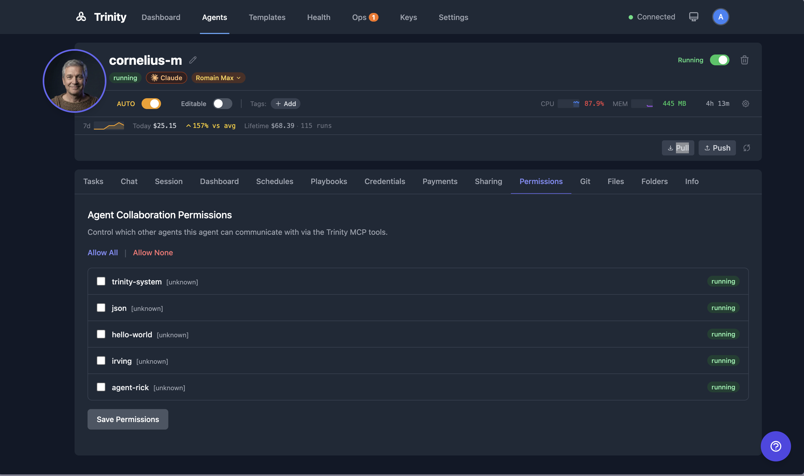

# Agent Permissions

Explicit permission model controlling which agents can communicate with which. Restrictive by default -- no agent can call another without explicit permission.

> 📺 **Watch:** [Trinity Platform Demo](https://youtu.be/ivljtZqsxeo) *(May 2026)* · [all videos](../videos.md)

## How It Works

1. Open the detail page of the agent that will *make* the calls and click its **Permissions** tab (next to **Sharing**). The tab is shown to the agent's owner and admins, and never on the system agent.
2. You will see a list of the other agents in the system.
3. Toggle each agent to allow or deny the current agent calling it. You can only grant access to agents you can access yourself. **Allow All** and **Allow None** set every row at once. Click **Save Permissions** to apply.
4. Permissions are directional: allowing Agent A to call Agent B does **not** allow Agent B to call Agent A. Each direction must be granted separately.
5. System agents (e.g., `trinity-system`) bypass permission checks entirely.

**Default behavior:**

- No permissions are auto-granted. All inter-agent communication must be explicitly allowed.
- The system agent (`trinity-system`) can call any agent without requiring permission.

**Enforcement:**

- When Agent A attempts to call `chat_with_agent("agent-b", ...)`, the MCP server checks whether Agent A has permission to communicate with Agent B.
- If permission has not been granted, the MCP tool returns an `Access denied` result and the call is blocked. An agent can always reach itself, and the agents it spawned.
- The backend enforces the same rule on its own routes, so an agent that calls the backend directly with its injected key cannot chat with, task, loop, or read the history and logs of an agent it is not permitted to call. A refused target answers like one that does not exist. See [Authentication → What an agent key reaches](../api-reference/authentication.md#what-an-agent-key-reaches).
- The same reach bounds what an agent key sees on **fleet-wide routes** — the ones with no agent in the path. The agent list, execution and sync-health summaries, slots, `/api/tags` counts, the event-subscription list, container telemetry, the operator queue, the agents named on each row of `GET /api/subscriptions`, the onboarding roster and the `/ws/events` stream all answer an agent key with its reach: itself, the agents it may call, and the agents it spawned with its current key — never its owner's whole fleet, even when the owner is an admin. The stream's roster is re-read when an agent is created, deleted, shared, unshared or renamed, so a newly spawned child appears without a reconnect. Two fleet sweeps that carry no task text or emails keep the owner's view: `GET /api/fleet/sync-audit` and `GET /api/monitoring/status` (`get_fleet_health`). `GET /api/mcp/keys/{id}` answers an agent key for its own key only. System views, the `/ws` ticket and the proactive-share switch are for people only, so an agent key gets `403` there. Deploying a version over an agent name the key cannot manage is refused (`403`, `NAME_OWNED_BY_ANOTHER_USER`) before anything is stopped.
- A permission means **may call**, never **may manage**: it does not let Agent A change Agent B's configuration, schedules, credentials or git token. Those need a permission an admin grants — see [Permissions to Change Itself](../agents/agent-configuration.md#permissions-to-change-itself).
- The same check gates starting a loop on another agent (`run_agent_loop`) and reading or stopping that loop (`get_loop_status`, `stop_loop`). See [Agent Loops](../automation/agent-loops.md#permission-checks-on-the-loop-tools).
- Permissions also gate shared folder access and event subscriptions between agents.
- A grant also lets the calling agent read the target's declared metrics (`get_metrics` with `agent` set to the target). These cross-agent reads count against the reader's own rate budget and are recorded in the audit log.
- A permitted call can still be refused if it is too deep in a chain of agent-to-agent calls. See [Agent Network → Chain-Depth Limit](agent-network.md#concepts).
- Every blocked call is recorded in the [audit log](../operations/audit-trail.md) as a refusal, so an admin can see which agent tried to reach which.

### Which skills a permission lets the caller run

**A peer may run what an agent declares; what an admin assigned needs a grant.**

- A permission lets Agent A run the skills Agent B **declares itself** (the skills in B's own repository).
- A skill **assigned to B from the skills library** (one at a time, or through a skill set) is not included. When A asks B to run it, the call is refused with `skill_not_granted` and nothing runs. The refusal is recorded in the audit log. A message that only mentions such a skill with a leading slash (`/skill-name`) is refused too; writing the name without the slash delivers it.
- B itself, B's schedules and B's loops can always run every skill B holds. People are unaffected.
- An agent can run every skill on an agent **it spawned**. The reverse is not true: a spawned agent calling its parent needs a grant like any other agent.
- To let A run one library skill on B, an admin turns it on in A's **Permissions** tab, under **Library skills on agents this agent can call**. Each skill is granted separately and can be turned off again. Removing A's permission to call B also removes these grants.
- **After an upgrade, nothing is granted.** **Settings → Agents** shows a notice listing every call between agents that used a library skill in the last 30 days and is now refused, with a **Grant** button for each. The Permissions list also shows when each library skill was last used.
- **Known gap:** the check looks for the skill's name (`/skill-name`) in the request. If A describes the work in plain words without naming the skill, B may still choose to run it. Grant permissions only to agents you would trust with B's skills.
- The MCP tool `get_agent_skills` marks each library skill with `peer_needs_grant`.

### When a withdrawn permission takes effect

Each control re-reads the permission at a different moment, so removing one (or replacing the set with **Save Permissions**) reaches each at a different time:

| Control | Checked | A withdrawn permission stops it |
|---|---|---|
| Calling the agent (`chat_with_agent`, loops, reading its work) | on every call | at the next call |
| Event subscriptions | when the subscription is created, and again on every delivery | at the next event. The subscription itself is kept, so granting the permission again resumes it |
| Shared folders the agent reads from the other agent | when the container is built | at the agent's next start, which rebuilds it without that folder. **Restart the agent to apply it immediately**; until then a running agent keeps the folder mounted |

Turning **Mount Shared Folders** off on the consuming agent works the same way: the next start removes every `shared-in` folder it still has.

## For Agents

- Agents do not need to handle permissions themselves. Granting and withdrawing is **human-only**: an agent-scoped API key is refused on the write routes below, so an agent can never grant itself or another agent access.
- The MCP tools that reach another agent's work check the permission before they run: chat, loops, and the tools that read another agent's schedules, executions, fan-out batches, reports, and operator-queue items. No special handling is required in agent code — read the `Access denied` result and ask the owner for a grant.

**API Endpoints**: See [Backend API Docs](http://localhost:8000/docs) for full schemas.

| Endpoint | Method | Description |
|----------|--------|-------------|
| `/api/agents/{name}/permissions` | GET | The agents this agent may call (any user with access to the agent) |
| `/api/agents/{name}/permissions` | PUT | Replace the whole set (owner or admin; human only) |
| `/api/agents/{name}/permissions/{target}` | POST | Grant one target (owner or admin; human only) |
| `/api/agents/{name}/permissions/{target}` | DELETE | Withdraw one target (owner or admin; human only) |
| `/api/agents/permissions-edges` | GET | Every permission edge between agents you can access, in one call |
| `/api/agents/{name}/peer-skills` | GET | For each agent `name` may call: the library skills on it, and whether `name` may run each |
| `/api/agents/{name}/peer-skills/{target}/{skill}` | PUT | Let `name` run the library skill `skill` on `target` (admin; human only) |
| `/api/agents/{name}/peer-skills/{target}/{skill}` | DELETE | Take that grant back (admin; human only) |
| `/api/skills/peer-grants/drift` | GET | Calls between agents that used a library skill in the last 30 days and are now refused (admin) |
| `/api/agents/{name}/reach/{target}` | GET | Whether `name` may call `target` — `{source_agent, target_agent, reachable}`, decided from the permission or the spawn record, never from which containers are running. The MCP server's agent-to-agent check reads it |

Every grant, replacement and withdrawal is written to the audit log.

## See Also

- [Agent Network](agent-network.md) -- how agents discover and communicate with each other
- [Event Subscriptions](event-subscriptions.md) -- pub/sub messaging between agents (gated by permissions)
