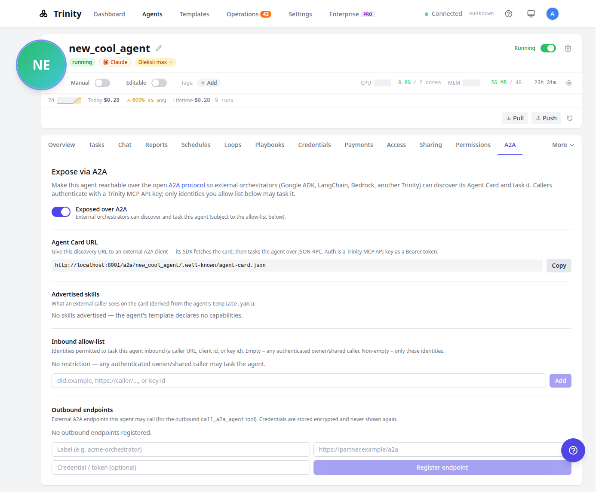
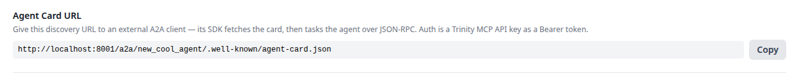

# A2A Protocol — expose & consume agents over Agent-to-Agent

Trinity speaks the open **[A2A (Agent-to-Agent) protocol](https://a2a-protocol.org)**, so an exposed Trinity agent is reachable by any A2A-capable orchestrator — Google ADK, LangChain, AWS Bedrock AgentCore, or another Trinity — and can, in turn, call external A2A agents. To an outside orchestrator, your agent looks like any other A2A agent; it never needs to know Trinity's internal API.

This guide covers both directions:

- **Inbound** — expose one of your agents so external clients can discover its Agent Card and task it.
- **Outbound** — call external A2A agents from a platform-wide list of endpoints an admin registers.

> **Availability.** The two directions are not gated alike.
>
> - **Inbound** — exposing an agent over A2A requires the A2A capability to be enabled (entitled) for your instance. When it isn't, the **A2A** tab is hidden and the public routes return `404` — off and invisible by default. Parts 1 and 2 assume it's enabled.
> - **Outbound** — calling an external A2A agent, and managing the registry of endpoints your agents may call, works on **every** edition. It has its own switch instead: outbound calling is off until an admin turns it on ([Part 3](#turn-it-on-admin-once)).

---

## Concepts

| Term | Meaning |
|------|---------|
| **Agent Card** | A JSON document (A2A's discovery primitive) advertising the agent's name, skills, endpoint URL, and auth scheme. Generated from the agent's `template.yaml`. |
| **Well-known URL** | The public, unauthenticated discovery URL: `{base}/a2a/{agent}/.well-known/agent-card.json`. This is what you hand to an external client. |
| **JSON-RPC endpoint** | `POST {base}/a2a/{agent}` — the A2A task endpoint (spec v0.3.x): `message/send`, `message/stream`, `tasks/get`, `tasks/cancel`. |
| **Inbound allow-list** | Optional per-agent list of caller account emails permitted to task the agent. Empty = any authenticated owner/shared caller. |
| **Outbound endpoints** | External A2A endpoints (+ optional credentials) agents may call — one platform-wide list, managed in **Settings › Integrations**. |
| **AAuth identity** | `aauth:<agent-name>@<issuer-host>` — how an agent on one Trinity instance is known to another once AAuth is on. The calling instance signs each call with a key only it holds; the receiving instance verifies the signature and admits only identities listed on the target agent's inbound allow-list. No shared secret. See [AAuth agent identity](#aauth-agent-identity--trinity-to-trinity-without-a-shared-key). |

---

## Part 1 — Expose an agent (inbound)

### Using the web UI

Open the agent's detail page and select the **A2A** tab.



1. **Flip "Expose over A2A" on.** It's OFF by default. While off, the public routes return `404` and the agent is invisible to the A2A ecosystem.
2. **Copy the Agent Card URL.** Once exposed, the panel shows the public discovery URL with a one-click **Copy** button. Hand this to whoever is wiring up the external orchestrator.

   
3. **Review the advertised skills** — exactly what an external caller sees on the card (derived from the agent's `template.yaml` capabilities).
4. **Manage the inbound allow-list** (optional) — add the account emails of callers that may task the agent. Leave it empty to allow any authenticated owner/shared caller. When AAuth is on, this is also where you list the `aauth:<agent>@<host>` identities of agents on other instances that may task this agent — for those, an empty list means nobody (see [Inbound allow-list](#inbound-allow-list)).
5. **Outbound endpoints** are not registered here. The tab links to **Settings › Integrations**, where an admin manages the platform-wide list `call_a2a_agent` reads — see *[Outbound endpoints](#outbound-endpoints)*.

### Using MCP (drive it from an agent / automation)

The same controls are available as MCP tools, so you can expose and configure agents conversationally or from a script:

| Tool | What it does |
|------|--------------|
| `get_agent_a2a_config` | Read exposure state, card URL, skills, allow-list, endpoints |
| `set_agent_a2a_exposure` | Toggle A2A exposure on/off |
| `get_agent_a2a_card` | Fetch the served Agent Card JSON |
| `set_a2a_inbound_allowlist` | Add/remove inbound identities |
| `register_a2a_endpoint` / `list_a2a_endpoints` / `remove_a2a_endpoint` | Manage the **platform-wide** outbound endpoint list — the one `call_a2a_agent` resolves against, and the same list the [Part 3](#register-an-endpoint-admin-human-only) routes manage. `register_a2a_endpoint` takes `auth_scheme` (`bearer` or `aauth`) to choose how calls to that endpoint authenticate. `agent_name` is accepted but ignored, because the list is not per-agent |

Exposure and credential operations are **owner/admin and human-only** — an agent-scoped key can't flip its own exposure. Reads use the standard agent-access gate.

The first four tools need the A2A capability enabled; the three outbound-registry tools do not, and work on every edition. Those three are **admin** and human-only — one tier up — because the list they write is platform-wide (see [Part 3](#register-an-endpoint-admin-human-only)).

---

## Part 2 — Consume an exposed agent (external orchestrator)

Once an agent is exposed, an external A2A client discovers and tasks it in three steps. The examples below use `curl` against a local instance (the frontend's front door on port `80`); a real A2A SDK does the same automatically.

### 1. Discover — fetch the Agent Card

```bash
curl -s http://localhost/a2a/new_cool_agent/.well-known/agent-card.json | jq
```

```json
{
  "protocolVersion": "0.3.0",
  "name": "new_cool_agent",
  "url": "http://localhost/a2a/new_cool_agent",
  "preferredTransport": "JSONRPC",
  "capabilities": { "streaming": true },
  "securitySchemes": { "bearerAuth": { "type": "http", "scheme": "bearer" } },
  "skills": [ ]
}
```

`url` is the JSON-RPC task endpoint; `securitySchemes.bearerAuth` tells the client to attach a **Trinity MCP API key** as a Bearer token.

### 2. Authenticate — a Trinity MCP API key

Issue an MCP key from **Settings → MCP Keys** (or the API) and share it with the external client. It's a `trinity_mcp_…` key, sent as `Authorization: Bearer $TOKEN` on every task call; unauthenticated calls fail closed with `401`. The examples below assume you've exported it: `export TOKEN=trinity_mcp_…`.

An agent on **another Trinity instance** needs no key when both instances have AAuth on: its call is signed with its own identity instead, and the key step above is skipped — see [AAuth agent identity](#aauth-agent-identity--trinity-to-trinity-without-a-shared-key). While AAuth is live here, the `401` an unauthenticated call gets also carries `Accept-Signature`, `Accept-Signature-Scheme: jwt` and `AAuth-Requirement: requirement=agent-token`, so an AAuth-aware client learns it may sign instead.

### 3. Task — JSON-RPC 2.0

**Send (`message/send`):**

```bash
curl -s -X POST http://localhost/a2a/new_cool_agent \
  -H "Authorization: Bearer $TOKEN" \
  -H 'Content-Type: application/json' \
  -d '{
    "jsonrpc": "2.0", "id": 1, "method": "message/send",
    "params": { "message": {
      "role": "user", "messageId": "req-1",
      "parts": [{ "kind": "text", "text": "Summarize today’s sales." }]
    }}
  }' | jq
```

Returns an A2A **Task**:

```json
{ "jsonrpc": "2.0", "id": 1, "result": {
  "id": "zAS45ahu2fwsHG9rwdKxQQ", "kind": "task",
  "status": { "state": "completed" },
  "artifacts": [{ "parts": [{ "kind": "text", "text": "…the answer…" }] }]
}}
```

**Long turns come back `working`.** `message/send` holds the request for up to
**25 seconds**. A turn that finishes inside that window returns the completed
Task above. A longer turn returns early with the same Task id and
`"status": { "state": "working" }` (or `"submitted"` while the agent's queue
has not started it yet) and no artifacts. The agent keeps working. Poll
`tasks/get` with that id until the state is terminal. The 25 seconds sit
under the 30-second read timeout of Trinity's own A2A client, so a caller
always gets the id before it gives up. Before this, a long turn surfaced as a
timeout and the id was lost.

You can choose the behaviour per call with the A2A
`params.configuration.blocking` flag:

| `blocking` | `message/send` answers |
|---|---|
| absent (default) | the completed Task, or `working` + id after 25 s |
| `true` | only at the terminal, however long the turn takes (your client must wait that long) |
| `false` | at once, with `working`/`submitted` + id; poll for the result |

A client that disconnects does **not** cancel the turn. It still runs to the
end, and the result is waiting on `tasks/get`.

**Streaming (`message/stream`, Server-Sent Events):** same params, `method: "message/stream"`. You receive a `working` status event, then a final `completed` task event. Streaming ignores `blocking`.

**Poll / cancel:** `tasks/get` and `tasks/cancel` take `{ "id": "<taskId>" }`. The `taskId` is the id from the send response, including a `working` one. A task the agent refused to run (a gated skill, for example) reads as `rejected` with the reason. It never stays `working`.

**Who may poll a task.** Only the credential that sent it. A task started with an API key can be polled and cancelled with that same key, and a task you sent while signed in, by you while signed in. Every other caller, including the agent's owner, an admin, and another key or agent of the same account, gets `Task not found`: the same answer as an id that does not exist. A key that is replaced (an agent's key is re-issued when the agent is recovered, for example) can no longer poll tasks the old key sent. To see every run of an agent, use its Executions view in Trinity.

> **Idempotency.** Re-sending the same `messageId` returns the original task **without re-executing** — safe to retry on a dropped connection. While that task is still running, the re-send returns it as `working` with the same id. Once it has finished, the re-send returns the completed Task. **Poll; don't re-send under a new `messageId`**, which would run the work twice.

---

## Inbound allow-list

By default, any caller authenticated as an owner/shared identity for the agent may task it. To restrict further, add identities in the **Inbound allow-list** section. With a non-empty list, only listed identities are accepted; everyone else gets `403`.

**Use the caller's Trinity account email** — the identity Trinity compares against is the calling account's email, falling back to its username when the account has no email. A DID or caller URL will never match, so a list containing only those denies every real caller.

**AAuth callers are listed by identity.** An agent calling from another Trinity instance over AAuth has no Trinity key, so this list is the only thing that admits it: add its `aauth:<agent>@<issuer-host>` identity, exactly as the calling instance's Settings page shows it. For AAuth callers the list **fails closed** — an empty list means nobody, and a policy error refuses rather than admits. The calling instance's host must appear in at least one `aauth:` entry before Trinity will even fetch that instance's keys, so a stranger cannot make your backend go and look up a domain nobody listed. See [AAuth agent identity](#aauth-agent-identity--trinity-to-trinity-without-a-shared-key).

> **The allow-list is a restriction, not a security boundary.** It layers on top of authentication — every caller has already passed the `401` and the owner/shared access check before it is consulted. For callers holding a Trinity key it also **fails open**: if the policy backend errors, the request is allowed rather than denied, matching Trinity's availability bias (an AAuth caller is refused on the same error, because nothing else has authenticated it). Don't rely on it as the only thing standing between an untrusted caller and the agent; that job belongs to authentication and sharing.

---

## Charge for inbound A2A calls

If an exposed agent has **Payments** configured (Agent → Payments tab, x402 via
Nevermined), callers without a Trinity key pay to task it over A2A — the same
paywall the paid chat endpoint has always had, now on the A2A door.

**Who pays, and who doesn't:**

| Caller | What happens |
|---|---|
| Another agent in your fleet, you, or anyone the agent is shared with (a valid Bearer MCP key) | Runs **free**, exactly as before. Nothing about your internal traffic changes. |
| A subscription tenant | Unaffected. |
| A stranger, on an agent with payments **off** | `401`, exactly as before. |
| A stranger, on an exposed agent with payments **on** | `402 Payment Required` with what to pay; a valid token runs the task and settles. |

**How an external client pays.** It reads the price off the discovery card, buys
plan credits from Nevermined, and sends the payment in the A2A message's
`metadata` under `x402.payment.payload`. The older `payment-signature` HTTP
header still works as a fallback, and if a client sends both, the one in the
message wins. The reply is a normal A2A Task carrying the payment status and a
receipt: the primary location is **`status.message.metadata`**, which is where
the x402 A2A extension puts it and where payment-aware SDKs read it. The same
object is also mirrored onto the Task's own top-level `metadata`, so a strictly
typed client sees the receipt rather than `metadata: null`. A **free** turn's
Task carries no `metadata` key at all.

**The card tells a client the price before it calls.** An exposed, priced agent's
`/.well-known/agent-card.json` carries a payment entry under
`capabilities.extensions` with the plan id, the credits per call, and a
`paymentInfoUrl` pointing at `/api/paid/{agent}/info` — so a payment-aware client
can pay on its **first** request instead of being refused once to learn the
price. An agent with no payment config has a byte-identical card to before.

> **A price on the card does not mean the door is open.** The card says what the
> agent *costs*; A2A exposure is what makes the paid A2A door reachable. On a
> build without the exposure feature, a configured price block points at a door
> that answers `404` — turn exposure on for that agent to open it.

Crypto and card (fiat) plans both work: Trinity advertises the x402 scheme that matches the agent's plan, and the 402's `resource.url` uses the public origin buyers reach you on. See [Nevermined Payments](nevermined-payments.md) for both.

**Time-based (duration) plans.** Set **Credits per Request** to `0`. A duration
plan charges by time, so Trinity sends no per-call amount and the plan decides
what a call burns; `0` says that honestly rather than claiming a per-call price
nothing will charge. The card then advertises the cost as plan-defined. (A
negative number is rejected.)

**Retrieving a paid result.** A paid `message/send` follows the 25-second rule
in [Task](#3-task--json-rpc-20): a long turn answers `working` with the task id.
The task is bound to the paying wallet **before** that answer is sent, so the
payer can poll `tasks/get` with the same token straight away, mid-turn
included. Any other caller gets the ordinary "task not found". The charge
settles when the turn completes, not at the `working` answer.

- **Don't re-send while it runs.** An identical paid message sent while the
  turn is still running returns the retryable `in_flight` error ("still being
  processed"). Poll the id you already have.
- **Cancelling mid-turn.** The payer may `tasks/cancel` a running paid task.
  A cancelled turn is **never charged** and delivers no answer.
- **If your client lost the id.** Re-send the identical message with the same
  token after the turn has finished. That replays the completed result instead
  of re-running (and re-charging) the work.

**Refusals, and what they mean:**

| Answer | Meaning |
|---|---|
| `401` | No price configured for this agent (or it isn't exposed) — authenticate with a Trinity key. |
| `402` | Pay, then retry. The body and the `payment-required` header say what to buy. |
| `403` | The token was rejected (or your wallet isn't on the agent's inbound allow-list). |
| `429` | Rate limited. The paying path is capped per source address **and** per agent. |
| `501` | Payments are configured but this Trinity install can't process one right now. |

A refusal that is **our** side being busy rather than a verdict on your token —
a payment checker that timed out, or too many payment checks in flight — is not
a `403`. It comes back as a JSON-RPC error carrying `data.retryable: true`, with
a `data.code` saying which case it is (`verify_unavailable` — we could not
check; `in_flight` — your own identical request is still running). Retry those
with the **same** token; never buy another. `payment_rejected` and `not_allowed`
carry `retryable: false`. On `message/stream` the same classification arrives as
an error event, because a status code cannot be sent once the stream has opened.

> **Paid calls are logged as money.** Each settled call records the paying wallet,
> the execution it paid for, and the source address. A delivered turn whose
> settlement fails still returns your result and is reported as unsettled rather
> than as a clean success — Trinity never claims it charged you when it didn't,
> or that it delivered for free when it is still reconciling.

---

## Outbound endpoints

The external A2A endpoints agents may call (name + URL + optional credential) are **one platform-wide list**, the one `call_a2a_agent` resolves. An admin manages it on the **Outbound A2A endpoints** panel in **Settings › Integrations**, with the routes in [Part 3](#register-an-endpoint-admin-human-only), or with `register_a2a_endpoint`; all three address the same list. Each endpoint has an authentication scheme: **Bearer credential** (the stored credential goes out as `Authorization: Bearer`) or **AAuth** (the call is signed as the calling agent and no credential is stored — see [AAuth agent identity](#aauth-agent-identity--trinity-to-trinity-without-a-shared-key)). Credentials are stored **encrypted and never shown again** — the UI only indicates whether an endpoint has one.

> **Endpoints registered on an agent's A2A tab before 1.0.** Earlier builds had a register form on the agent's A2A tab. It wrote a separate per-agent list that `call_a2a_agent` never read, so those endpoints answered `endpoint_not_found`. The form is gone. If any such rows remain, the tab lists them as **not callable** with a **Remove** button: re-add the ones you need in Settings › Integrations, then remove them from the tab.

---

## Part 3 — Call an external A2A agent (outbound)

Your agents can task *other* people's A2A agents — a Google ADK agent, a LangChain or Bedrock agent, or another Trinity instance — and get the answer back inside a single tool call.

### Turn it on (admin, once)

Outbound calls are **off by default**. Enable them either way:

```bash
# .env, then restart
A2A_OUTBOUND_ENABLED=true
```

…or flip it at runtime with no restart (the stored setting wins over the environment variable):

```bash
curl -X PUT http://localhost:8000/api/settings/a2a_outbound_enabled \
  -H "Authorization: Bearer $TOKEN" -H 'Content-Type: application/json' \
  -d '{"value": "true"}'
```

`GET /api/settings/feature-flags` reports `a2a_outbound_available` so you can confirm it took.

Once a stored setting exists it wins in both directions, and the environment variable is ignored until you clear the row with `DELETE /api/settings/a2a_outbound_enabled`. If `.env` says `true` and the feature still looks off, that stored row is why.

In the UI, the same switch is **Allow outbound A2A calls** on the **Outbound A2A endpoints** panel in **Settings › Integrations** (admin only); the panel reads **Calls allowed** or **Calls off** beside it, and warns that a registered endpoint cannot be called while the switch is off.

### Register an endpoint (admin, human-only)

An agent **cannot supply a URL**. It picks a target by *name* from a list an administrator registered:

```bash
curl -X PUT http://localhost:8000/api/settings/a2a-endpoints \
  -H "Authorization: Bearer $TOKEN" -H 'Content-Type: application/json' \
  -d '{
        "name": "research-partner",
        "url": "https://partner.example.com/a2a/researcher",
        "credentials": "their-api-token"
      }'
```

Registry rules worth knowing before your first attempt:

- **Upsert is by name.** Re-sending the same `name` updates that endpoint. Omitting `credentials` on an update **keeps** the stored secret; send `"clear_credentials": true` to remove it.
- **Credentials must be printable ASCII with no whitespace or line breaks** (≤8192 chars). A token pasted with a trailing newline is rejected with `422` — that is the single most common first-try failure.
- **Up to 50 endpoints**, and each URL is SSRF-validated when you register it *and* re-validated on every call.
- **If the credential is a payment token, say so — or let Trinity notice.** `"credential_kind": "payment_token"` makes Trinity attach it as an x402 payment — the `x402.payment.payload` metadata plus the `payment-signature` header — **in addition to** the `Authorization: Bearer` header every credentialed call already carries, not instead of it. You can leave the field out: Trinity infers it from the value, so a token pasted straight from a paid provider works without you knowing the field exists. The response tells you which it concluded. Send `credential_kind` **alone** (no `credentials`) to re-label a secret you already stored, and note that it cannot be combined with `clear_credentials` — that pair is rejected with `422` rather than guessing which you meant.
- **Pick the authentication scheme.** `"auth_scheme"` is `bearer` (the default for a new endpoint) or `aauth`. An `aauth` endpoint holds **no** credential — sending one is refused with `422`, and switching an existing endpoint to `aauth` drops the one it had — and its URL must be `https://` on the default port, because the remote verifies the signed host against its own issuer, which carries no port. Omit the field on an update to keep the stored scheme: renaming or repointing an endpoint never silently turns an AAuth one into a bearer one. See [AAuth agent identity](#aauth-agent-identity--trinity-to-trinity-without-a-shared-key).

The **Outbound A2A endpoints** panel does the same from the browser. Its table shows each endpoint's **Name**, **URL** and **Auth** (`Bearer · credential stored`, `Bearer · no credential` or `AAuth · signed as the agent`) with **Edit** and **Remove** per row; the **Register an endpoint** form below it takes **Name**, **A2A URL**, **Authentication** (**Bearer credential** or **AAuth (signed as the agent)**) and, for bearer only, a **Credential** (leave it blank on an edit to keep the stored one). Editing a bearer endpoint over to AAuth warns that saving drops the stored credential; **Remove** asks for confirmation and deletes any stored credential with the endpoint.

```bash
# List them (credentials are never returned — only whether one is set)
curl -H "Authorization: Bearer $TOKEN" http://localhost:8000/api/settings/a2a-endpoints

# Remove one
curl -X DELETE -H "Authorization: Bearer $TOKEN" \
  http://localhost:8000/api/settings/a2a-endpoints/research-partner
```

The URL must be **HTTPS** and must resolve to a public address; Trinity refuses anything pointing inside your network. It re-checks this on **every call**, not just at registration, so a hostname that later resolves somewhere internal stops working rather than being trusted because it was once accepted. The one exception is a host an admin has put on the outbound endpoint allowlist — see [Between your own instances on a private network](#between-your-own-instances-on-a-private-network).

> **⚠ Registering an endpoint is a trust decision, not a configuration step.**
> Trinity removes the literal credential from anything the remote sends back. It **cannot** stop a remote that base64-encodes, splits or otherwise transforms it — and an agent under prompt injection can be talked into asking for exactly that. **Registering an endpoint grants that endpoint the ability to exfiltrate its own credential.** Register peers you would trust with the token you are handing them.

**Owning the agent is not enough.** This registry is **admin and human-only** on every edition. The list is platform-wide, so registering an endpoint hands a credentialed egress target to *every* agent on the instance — a fleet-wide grant rather than one agent's setting, and Trinity keeps grants human-only. An agent-scoped key is refused on all three operations.

The same three operations are available over MCP, so this is not a `curl`-only surface:

```
register_a2a_endpoint(name        = "research-partner",
                      url         = "https://partner.example.com/a2a/researcher",
                      credentials = "their-api-token",
                      # optional — inferred from the value when omitted;
                      # "payment_token" for an x402 token bought after a 402
                      credential_kind = "api_key",
                      # optional — "bearer" (default) or "aauth" (signed as the
                      # calling agent; no credentials allowed); omit to keep
                      auth_scheme     = "bearer")       # -> { endpoint, outbound_enabled }
list_a2a_endpoints()                                    # -> { endpoints, outbound_enabled }
remove_a2a_endpoint(endpoint_id = "research-partner")    # id or name; first match wins
```

They need an **admin** key held by a person, and they work whether or not the A2A capability is enabled. `register_a2a_endpoint` reports `outbound_enabled`: when it is `false`, the response also names the one admin step above that makes the endpoint callable — so a registration you cannot yet use says so instead of looking finished. `agent_name` is accepted and ignored.

### When the remote charges for the call

Some A2A agents are priced. Such a remote answers **402 Payment Required**, and Trinity passes that through as a 402 rather than as a generic failure:

```json
{
  "detail": {
    "reason": "payment_required",
    "message": "This agent charges 1 credit per request.",
    "payment": {
      "summary": {"plan_id": "plan_42", "scheme": "exact",
                  "network": "base-sepolia", "credits_per_request": 1,
                  "resource_url": "https://partner.example.com/a2a/researcher"},
      "x402": { "…the remote's own requirements object…" },
      "truncated": false
    },
    "remote_status": 402,
    "task_id": "task-abc"
  }
}
```

An agent sees `payment_required: true`, the same `payment` block, and `do_not_retry: true`. **Trinity never buys anything.** The sequence is:

1. The agent relays the price to a person **once** and stops. Retrying cannot work, and calling a different endpoint is not a substitute.
2. A person buys the access token from the provider.
3. An admin stores it on the endpoint: `register_a2a_endpoint(name="research-partner", url=…, credentials="<the token>")` — the kind is inferred, or pass `credential_kind="payment_token"` explicitly.
4. The agent calls again, passing the `task_id` the refusal returned, so the remote resumes the same task instead of starting a fresh charge.

Two things worth knowing before you get there:

- **402 means "buy this", 403 means something else.** A remote 403 comes back as a `502` with `reason: "rpc_forbidden"` — or `"payment_rejected"` when the stored credential is a payment token the remote refused (spent, expired, or out of credit). Both carry `remote_status`, so you can always tell the two apart.
- **Some payment tokens are single-use.** An x402 v3 token authorises exactly one settlement. Trinity flags it (`credential_single_use: true`, plus a hint in the registration response) rather than refusing it: after one paid call you will need to store a fresh token.

Trinity reads the price and attaches a token you stored. It does not negotiate, does not purchase, and does not show the agent payment receipts.

### Call it (from an agent)

```
call_a2a_agent(
  agent_name  = "my-agent",
  endpoint    = "research-partner",     # the NAME you registered, not a URL
  message     = "Summarise the latest findings on X",
  dedup_label = "research-step-1"
)
```

`dedup_label` is **required**, and it must differ for each distinct question you ask in one turn. Calls are deduplicated on the endpoint and the conversation — never on the message text — so reusing a label returns the *earlier* answer instead of asking the new question.

If the remote replies with `state: "working"` or `"submitted"`, it is still thinking. A Trinity remote answers this way for any turn longer than 25 seconds. The reply carries `task_id`. **Poll it; never re-send the message**, which would ask the question again:

```
get_a2a_task(agent_name="my-agent", endpoint="research-partner", task_id="<task_id from the call>")
```

### What comes back

| Field | Meaning |
|---|---|
| `state` | `completed`, `working`, `submitted`, `failed`, `canceled`, `rejected`, … (`working`/`submitted` = still running; poll `task_id`) |
| `text` | The remote's answer (capped at 32 KB, truncation marked) |
| `task_id` / `context_id` | Handles for polling or continuing the conversation |
| `protocol_version` | The A2A dialect negotiated from the remote's card |
| `truncated` | `true` when the reply exceeded the 32 KB response cap and was cut |
| `endpoint` | Which registered endpoint answered |
| `replayed` | `true` when this is a deduplicated replay of an earlier identical call, not a fresh answer |

Messages are capped at **100,000 characters** on the way out.

Pass the current `execution_id` alongside `dedup_label` when you have one: together they make the call at-most-once even if the turn itself is re-delivered.

A few behaviors that surprise people, all deliberate: the **calling agent's container does not need to be running** (the backend places the call, not the container); **read-only mode and the autonomy switch do not gate outbound calls**; and an **ephemeral agent's own key cannot place them** at all.

### Trinity → Trinity

Two ways, both over A2A v0.3 with no protocol configuration:

- **With a key.** Register the remote instance's agent endpoint (`https://their-trinity.example.com/a2a/their-agent`) with a **Trinity MCP API key from that instance** as the credential. The remote sees the call as whoever owns that key.
- **Without a key.** Turn on AAuth on both instances and register the endpoint with **Authentication: AAuth**. Each call is then signed as the calling agent (`aauth:<agent>@<your-host>`), and the remote admits it only if that identity is on the target agent's inbound allow-list. Nothing is issued, stored or rotated on either side. See [AAuth agent identity](#aauth-agent-identity--trinity-to-trinity-without-a-shared-key).

### Between your own instances on a private network

When your Trinity instances share a private network (a tailnet or a VPN) and serve plain HTTP on it, their agents can call each other over it instead of the public internet. Every call still carries a key: the private network only changes which **addresses** Trinity will call, never who may call an agent.

**1. Allow the other instance's host (admin, on the calling instance).** Add the provider instance's name on the network, its address range, or both, to the outbound endpoint allowlist:

```bash
curl -X PUT http://localhost:8000/api/settings/a2a-trusted-networks \
  -H "Authorization: Bearer $ADMIN_TOKEN" -H "Content-Type: application/json" \
  -d '{"entries": ["100.64.0.0/10", "*.your-tailnet.ts.net"]}'
```

The platform refuses entries that would cover its own Docker networks, loopback, link-local or reserved ranges, or anything broader than a /8. The list is read only when **this** instance calls out; it never lets anyone call in.

**2. Provider side:** in the agent's **A2A** settings, turn on **Expose over A2A**, exactly as for any other caller.

**3. Caller side:** register `http://<provider-instance>.<your-tailnet>/a2a/<agent>` as an outbound endpoint, with a **Trinity MCP API key from the provider instance** as the credential (see [Trinity → Trinity](#trinity--trinity)). Plain `http://` and a private address are accepted only because the host is on the allowlist. The check runs again on every call, so a name that later resolves outside the allowed ranges is refused.

A call that arrives without a key gets `401`, whichever network it comes from.

### Troubleshooting

| Symptom | Cause |
|---|---|
| `outbound_disabled` (404) | `A2A_OUTBOUND_ENABLED` is off |
| `endpoint_not_found` (404) | No endpoint registered under that name — check spelling, or ask an admin |
| `endpoint_not_https` (400) | The registered URL is `http://` and its host is not on the outbound endpoint allowlist. Re-register it as `https://` — Trinity refuses rather than silently upgrading, so a credential never travels in clear — or, for one of your own instances on a private network, ask an admin to allow its host |
| `endpoint_private_address` (400) | The hostname resolves inside your network and is not on the outbound endpoint allowlist |
| `card_origin_mismatch` (502) | The remote's agent card points somewhere other than the registered host. Trinity refuses: a card cannot redirect a credentialed call |
| `endpoint_dns_failure` (400) | The hostname does not resolve. Trinity treats a DNS failure as fatal rather than retrying blindly |
| `aauth_agent_only` (403) | The endpoint uses the AAuth scheme and the caller is not the agent's **own** key. Only the agent itself may place a signed call — an owner, a shared user or an admin cannot make the backend sign as the agent |
| `aauth_disabled` (400) | The endpoint uses the AAuth scheme but AAuth is off, or has no valid issuer, on **this** instance. Turn it on in **Settings › Integrations** |
| `rpc_forbidden` (502) on an AAuth endpoint | The remote verified the signature but the calling agent's identity is not on the target agent's inbound allow-list there. Ask that instance's admin to add `aauth:<agent>@<your-host>` |
| `card_url_ambiguous` (502) | The remote's card declares a URL that doesn't unambiguously match what you registered. Register the origin, or a URL matching the card's declared `url` exactly |
| `unsupported_protocol_version` (502) | The remote speaks A2A `1.x`, which Trinity deliberately refuses — there is no peer to verify that dialect against |
| `payment_required` (402) | The remote charges for this call. `detail.payment` carries its price and plan — relay it to a person once and stop; nothing an agent can do changes the answer |
| `payment_rejected` (502) | A payment token you stored was refused by the remote (spent, expired, or out of credit). Store a fresh one |
| `rpc_forbidden` (502) | The remote answered 403 for a reason of its own — check the credential and your access with that provider. Never Trinity's own 403 |
| `message_too_long` (422) | The message exceeds 100,000 characters |
| `timeout` (504) | The remote did not answer in time. If it accepted a task, poll with `get_a2a_task`. A Trinity remote answers a long turn with `working` + `task_id` instead of timing out |
| 409 | The same labelled call is already in flight — use a distinct `dedup_label` |
| 429 | Too many outbound calls: the limit is **30 per minute per agent** and **120 per minute fleet-wide** |

### Timeouts, and what "it failed" actually means

A single call is bounded at **30 seconds** for the remote's reply and **45 seconds** wall-clock including the card fetch. The MCP tool gives up on its own side a little earlier (`MCP_A2A_TIMEOUT_MS`, 40 seconds by default) so it can hand the agent a structured receipt instead of an opaque network error.

A long turn on a **Trinity** remote is not a timeout. The remote answers `working` with a `task_id` after 25 seconds, well inside those bounds, and you poll `get_a2a_task` for the result. A timeout now means the remote (or the network to it) did not answer at all.

That receipt matters: a timed-out `call_a2a_agent` returns `possibly_delivered: true`. The remote may well have accepted and run the task. **Do not simply re-send** — poll with `get_a2a_task` if you have a `task_id`, or reuse the same `dedup_label`, which replays the earlier answer rather than paying for the work twice.

---

## AAuth agent identity — Trinity to Trinity without a shared key

AAuth lets an agent on one Trinity instance call an agent on another **as itself**. The calling instance signs every call with a key only it holds, and sends an agent token naming the caller as `aauth:<agent-name>@<issuer-host>`. The receiving instance fetches the caller's published key set over HTTPS, verifies the token and the signature over the exact request, and admits the call only if that identity is on the target agent's inbound allow-list. No MCP key is minted, stored or rotated on either side, and a captured request cannot be replayed. The wire is still A2A JSON-RPC over `POST /a2a/{agent}`: AAuth changes how the caller is authenticated, not how it talks. It is **off by default**; with it off, nothing in this section exists and A2A behaves exactly as described above.

What the receiving instance actually checks is that the caller controls the key published at `https://<issuer-host>/.well-known/…` — it says nothing about who runs that instance. Listing `aauth:x@partner.example.com` is trusting whoever controls that domain, and one instance key signs for every agent on it, so the unit of trust is the peer **instance**, not one agent. An allow-list entry means that remote agent may ask yours for anything it can do; revoking it is deleting the entry.

### Turn it on (admin, in the browser)

Open **Settings › Integrations** (admin only) and find the **Calls between Trinity instances (AAuth)** panel. Its badge reads **Off**, **On, inactive** or **Live**.

1. **Set the issuer.** In **Issuer — this instance's public HTTPS host**, enter the origin other instances reach this one on — `https://trinity.example.com` — and press **Save**. The issuer is this instance's AAuth identity domain, so it is strict: `https://`, a lowercase DNS host name with a dot, no port, no path, no IP address. Nothing is repaired for you; a value that needs fixing is refused by name (`invalid_issuer`). It **must equal the host in the agents' Agent Card URLs** (`PUBLIC_CHAT_URL`), because the caller signs the host from the card and the callee verifies against its issuer — a mismatch fails every call. Changing a live issuer asks for confirmation (**Change issuer**), because every agent here becomes `aauth:<agent>@<new host>` and peers that listed the old identities refuse their calls until they list the new ones.
2. **Flip "Sign and accept agent-to-agent calls" on.** Switched on without a valid issuer, the panel shows **On, inactive** and a warning — AAuth is then off in effect: nothing is published, signed or accepted. With a valid issuer it reads **Live**.
3. **Read the "Ready to call another instance?" checklist.** It names what a call to another instance still needs, each item with its next step: *Issuer set to this instance's public HTTPS host*, *AAuth switched on*, *Outbound A2A calls allowed* (the switch on the **Outbound A2A endpoints** panel below) and *An endpoint registered with the AAuth scheme*. The instance being called also needs AAuth on and must list your calling agent's identity on the agent it calls.

The panel prints the identity your agents carry — `aauth:<agent-name>@<issuer host>` — which is the string the other instance's admin adds to their agent's inbound allow-list. Each value shows whether it came from the settings row or from `AAUTH_ENABLED` / `AAUTH_ISSUER` in `.env`; switching it in the panel overrides the environment from then on, in both directions, until the row is cleared. The **What this does not protect against** disclosure under the panel lists the limits worth reading once: the instance key signs for every agent; identities are keyed by agent **name** (a renamed agent is a new identity, and a deleted name re-created later inherits what peers granted the old one); replay protection needs Redis and refuses calls while Redis is unavailable; a proxy that rewrites signed headers breaks every call.

The same settings are `GET` / `PUT /api/settings/aauth`. The read is admin-only; the write is admin **and interactive** — an MCP key of any scope is refused, because publishing this instance's key and choosing what every agent is called are grants. `PUT` writes only the fields you send (`enabled`, `issuer`, and the prototype fields below), answers `422` with `invalid_issuer` / `invalid_person_server` / `invalid_resource_allowlist` for a value it will not store, and is audited. The generic `PUT`/`DELETE /api/settings/{key}` refuses every `aauth_*` key, so this route is the only door. For a first boot you can seed the same values with `AAUTH_ENABLED` and `AAUTH_ISSUER` in `.env` (see [Single-Server Deployment → `.env` reference](../guides/deploying/single-server.md#env-reference)).

### Call an agent on another instance

On the **calling** instance: register the remote agent's A2A URL on the **Outbound A2A endpoints** panel with **Authentication** set to **AAuth (signed as the agent)** (or `auth_scheme: "aauth"` through `register_a2a_endpoint` / `PUT /api/settings/a2a-endpoints`). The URL must be `https://` on the default port, and the endpoint stores no credential. Then the agent calls it exactly as any other endpoint: `call_a2a_agent(endpoint="…", message=…, dedup_label=…)`.

On the **receiving** instance: AAuth on, the target agent exposed over A2A, and the caller's identity on that agent's inbound allow-list (`aauth:<agent>@<calling-host>`). A peer on a private network must also be on the outbound endpoint allowlist of the caller and serve HTTPS with a certificate the caller trusts — AAuth never relaxes the HTTPS rule.

Three things differ from a bearer call:

- **Only the agent's own key may place it.** For a bearer endpoint, an owner, shared user or admin calling `POST /api/agents/{agent}/a2a/call` only changes who is attributed; for an AAuth endpoint it would let a person make the backend sign *as the agent*, so anyone but the agent itself is refused `403 aauth_agent_only`. The agent's injected MCP key is the right caller.
- **The card is fetched under the agent's path first.** A Trinity peer serves its card at `/a2a/{agent}/.well-known/agent-card.json`, so for an AAuth endpoint Trinity looks there before the origin root.
- **The remote's `403` means "not listed".** The signature verified; the identity is not on that agent's allow-list. It comes back as `rpc_forbidden` — ask the other admin to add the identity, and never retry with a different endpoint.

The activity row and the audit row for the call record `auth: aauth` — never a token.

### Accept calls from another instance

With AAuth live, an exposed agent's Agent Card gains a second security scheme, `aauth`, **after** `bearerAuth`, so an AAuth-unaware client that takes the first entry still sees bearer. A signed request — one carrying a `Signature-Key` header — takes the AAuth path on `POST /a2a/{agent}`; everything else is the bearer path, unchanged. Trinity verifies cheapest-first and reads the body last: exposure (an unexposed agent is the uniform `404`), header shape, the token's claims, then the **trusted-issuer pre-gate** — the caller's host must appear in at least one `aauth:` entry on this agent's allow-list before any network fetch — then the caller's published metadata and key set (same-origin, one 8-second deadline, cached), the token signature, the signature over the request including the body digest, a replay check in Redis, and finally the exact allow-list membership. The task then runs through the same dispatch path as any other trigger, with **no Trinity user** attached: no owner role travels with an AAuth caller.

| Answer | Meaning |
|---|---|
| `401` + `Signature-Error: error=<code>` (problem-details body) | The signature, token, digest or replay check failed — `invalid_signature`, `invalid_jwt`, `expired_jwt`, `unknown_key`, `issuer_mismatch`, `clock_skew`, … |
| `403` | Verified, but the identity is not on this agent's inbound allow-list. Nothing is wrong with the signature |
| `404` | The agent is not exposed, or does not exist — indistinguishable on purpose |
| `503` | Redis is unavailable, so the replay check cannot run. AAuth refuses rather than admit a request it cannot prove unique |

Limits on the inbound side: `message/stream` is refused for AAuth callers (`message/send` and polling only), and an AAuth caller can `tasks/get` / `tasks/cancel` only tasks it started. Every decision is audited with actor type `external_agent` and the identity — a refused signature is recorded only once the token itself verified, so a stranger cannot fill your audit log with identities it invented. Accepting signed calls relies on the per-agent inbound allow-list, which is part of the A2A inbound capability: an instance where the **A2A** tab is hidden can sign outbound calls but accepts none.

### Discovery routes and `whoami`

While AAuth is live, the instance publishes three unauthenticated documents (rate limited per IP, like the card route). Peers fetch them; you do not need to.

| Endpoint | Method | Description |
|---|---|---|
| `/.well-known/aauth-agent.json` | GET | Who this instance is as an agent provider: `issuer`, `jwks_uri`, accepted signature algorithms |
| `/.well-known/aauth-jwks.json` | GET | The public key agent tokens from this instance verify against |
| `/.well-known/aauth-resource.json` | GET | How to call this instance's agents: `access_mode: agent-token`, the signature window, the extra signed components |

All three answer a uniform `404` unless AAuth is live, so a default install publishes nothing. The front door must route `/.well-known/aauth-*` to the backend: the production nginx config does; the dev server's proxy does not, which is one more reason a local `localhost` stack cannot be an AAuth peer.

To prove the setup against a verifier that is not Trinity, run the operator diagnostic inside the backend container. It signs one request as the named agent to AAuth's public `whoami` service, which fetches your well-known documents over the internet and echoes the identity it verified:

```bash
docker exec trinity-backend python -m services.aauth.whoami my-agent
```

It needs AAuth live and the issuer's well-known documents reachable from the internet; exit code `0` means the remote verifier answered `200`. It is deliberately a CLI, not an endpoint: signing as an agent is placed only on the A2A call path.

### What happens when it is off

Off, or on without a valid issuer (**On, inactive**), AAuth is inert rather than half-on: the three well-known documents answer `404`, Agent Cards are byte-identical to a build without AAuth, a signed inbound request falls through to the ordinary bearer `401`, an outbound call to an `aauth` endpoint is refused `400 aauth_disabled`, and the `whoami` diagnostic exits with *AAuth signing unavailable*. The instance key, created on first use and stored encrypted with the other platform credentials, stays put; it is never regenerated on its own, because a silent new key would change this instance's identity under every peer that trusts it.

### Prototypes: acting for the owner, and calling AAuth resources

Two further legs of AAuth ship as **prototypes behind a second switch**, `AAUTH_PROTOTYPE_ENABLED` (`prototype_enabled` on `PUT /api/settings/aauth`). They need the main switch too; the **Calls between Trinity instances (AAuth)** panel only reports them (*Person-token and resource-calling prototypes: on/off*) — there is no UI to configure them, and their MCP tools answer `aauth_disabled: true` while either switch is off. Expect them to change.

**Person-token binding** — an agent proves *whose* agent it is. The agent calls `request_person_token(resource)` (self-acting: agent-scoped key only, no `agent_name`). Trinity signs a request to the person server named in `AAUTH_PERSON_SERVER` / `person_server` (`https://<host>`, same strict rule as the issuer; unset answers `409 person_server_unconfigured`). The first time, the answer is `pending` with a link and a code: the agent must relay them **only to its owner, privately** — whoever approves first at the person server becomes the person the agent acts for — and call again with `pending_handle` after `retry_after` seconds until the outcome is `issued`. The token is held by the platform and never shown to the agent, which sees only its metadata; `refused` outcomes (`denied`, `expired`, `gone`) are final. Route: `POST /api/agents/{agent}/aauth/person-token`.

**Resource calling** — an agent calls an external AAuth-protected API as itself. `call_aauth_resource(resource, method, path, body, justification, dedup_label)` sends `{resource}{path}` signed as the agent and climbs the resource's requirement ladder for it: agent token, then the owner's person token, then an auth token the person server mints against the resource's challenge (a resource that delegates to its own access server is supported; the token still goes through your person server). The agent gets `result` with the resource's answer (capped, every token scrubbed), `token_kind` and the `challenges` it met; `interaction_required` / `pending` with a handle when the owner must consent; or `denied` / `expired` / `refusal` with `do_not_retry`. A later call with a new `dedup_label` reuses the held auth token with no new consent. The resource must be on the **fail-closed allowlist** `AAUTH_RESOURCE_ALLOWLIST` / `resource_allowlist` — a comma-separated list or JSON array of `https://<host>` origins, admin-only; unset, malformed or one bad entry means **no** resource is callable, and an unlisted one is `403 resource_not_allowed`. Only the agent's own key may call (`403 aauth_agent_only`). Route: `POST /api/agents/{agent}/aauth/resource-call`; both prototype routes answer the uniform `404` while the prototypes are off.

---

## Behavior & security notes

- **Safe by default** — exposure is OFF for every agent until you turn it on; a non-exposed or non-existent agent returns a uniform `404` (no way to enumerate which agents exist).
- **Auth is fail-closed** — every task call validates the Bearer MCP key; a bad/missing token is `401`. The one exception is an exposed agent with **payments on**, where a caller with no Trinity key gets `402` instead so it can pay (see [Charge for inbound A2A calls](#charge-for-inbound-a2a-calls)). A credential Trinity recognises and then refuses — a connector-scoped or ephemeral key — stays refused and never falls through to the paying path.
- **The front door must reach it** — external clients hit your public URL, not the backend port directly. Trinity proxies `/a2a/` to the backend (nginx in production, the dev proxy locally). Set `PUBLIC_CHAT_URL` so the card's published `url` is reachable from outside your network.
- **Stopped agents** still serve a card (from container labels); tasking a stopped/unreachable agent returns a structured JSON-RPC error, never a 5xx.
- **Every inbound task is audit-logged** (`source=a2a`, with the caller identity).
- **Outbound is off by default too**, and an agent can only reach endpoints an administrator registered by name — it can never supply a URL of its own, so a prompt injection cannot aim Trinity at an address of the attacker's choosing.
- **An agent may only call as itself.** Sharing an agent lets someone reach it; it does not let one agent spend another agent's registered endpoint credential. On an AAuth endpoint this goes one step further: only the agent's own key may place the call, so no person can make the backend sign as the agent.
- **AAuth publishes a key, not a secret, and only once you turn it on.** Off by default; off (or on without a valid issuer) it publishes nothing, signs nothing and accepts nothing. On, an AAuth caller never becomes a Trinity user — no role travels with it, and it is admitted only by an exact entry on the target agent's inbound allow-list, which fails closed. Changing the AAuth switch or issuer is admin, browser-session-only and audited ([AAuth agent identity](#aauth-agent-identity--trinity-to-trinity-without-a-shared-key)).
- **Outbound calls are audit-logged** with the endpoint name and the remote **host** — never the full URL, the message, or the credential. For a payment token the audit row records the *kind*, never the value, and a completed payment is recorded so you can see money leaving.
- **A priced remote is never paid automatically.** Trinity reads a 402 and can attach a token an administrator stored; it never purchases, never retries a priced call, and never replays a stored "payment required" answer after you have paid.
- **What a remote sends back is treated as untrusted text, including its price.** The payment details that reach an agent are a fixed, size-capped shape with the credential scrubbed out — a remote cannot smuggle extra instructions or your own token back through the price it quotes.

---

## Reference

### Public routes (per exposed agent)

| Method | Path | Auth | Purpose |
|--------|------|------|---------|
| GET | `/a2a/{agent}/.well-known/agent-card.json` | none | Discovery card |
| POST | `/a2a/{agent}` | Bearer MCP key **or** an x402 payment (when the agent is priced) | JSON-RPC task endpoint |

### Outbound routes (calling out)

| Method | Path | Auth | Purpose |
|--------|------|------|---------|
| POST | `/api/agents/{agent}/a2a/call` | Bearer (owner/shared; an agent key only as itself) | Task a registered external A2A agent |
| POST | `/api/agents/{agent}/a2a/task` | same | Poll a remote task by id |
| GET/PUT | `/api/settings/a2a-endpoints` | admin, human-only | List / register endpoints |
| DELETE | `/api/settings/a2a-endpoints/{ref}` | admin, human-only | Remove an endpoint — `ref` is its id **or** its name |

The two agent routes return `404` while outbound calling is off. The three settings routes are **not** gated by the flag: an admin can register endpoints before switching the feature on, which is the intended order. They are also the routes behind `register_a2a_endpoint` / `list_a2a_endpoints` / `remove_a2a_endpoint`, so the MCP tools and these routes cannot disagree.

### AAuth routes

| Method | Path | Auth | Purpose |
|--------|------|------|---------|
| GET | `/.well-known/aauth-agent.json` | none (`404` unless AAuth is live) | Agent-provider metadata |
| GET | `/.well-known/aauth-jwks.json` | none (`404` unless live) | This instance's public key set |
| GET | `/.well-known/aauth-resource.json` | none (`404` unless live) | Resource metadata for the A2A task endpoint |
| POST | `/a2a/{agent}` | a `Signature-Key`-signed request (AAuth) **or** Bearer | The same task endpoint; a signed request takes the AAuth path |
| GET | `/api/settings/aauth` | admin | The switches, issuer, person server and resource allowlist, each with its source, plus `live` and the readiness checklist |
| PUT | `/api/settings/aauth` | admin, **interactive only** (no MCP key of any scope) | Change any of them; partial; `422 invalid_*`; audited |
| POST | `/api/agents/{agent}/aauth/person-token` | the agent's **own** key | Prototype: obtain or resume a person-token binding (`404` while the prototypes are off) |
| POST | `/api/agents/{agent}/aauth/resource-call` | the agent's **own** key | Prototype: call an allow-listed AAuth resource, or resume a pending call (`404` while off) |

`GET /api/settings/a2a-endpoints` answers `{"endpoints": [{"id": …, "name": …, "url": …, "has_credentials": true, "credential_kind": "api_key"}], "enabled": false}` — credentials are write-only and never echoed back, and `enabled` is a second way to confirm the flag. `credential_kind` appears only where a credential is stored (`api_key` or `payment_token`), with `credential_single_use: true` alongside it when the stored payment token is good for one settlement.

### JSON-RPC methods

| Method | Purpose |
|--------|---------|
| `message/send` | Send a message, get a Task (the result, or `working` + id after 25 s; `configuration.blocking` overrides) |
| `message/stream` | Same, streamed over SSE |
| `tasks/get` | Fetch a task's current state |
| `tasks/cancel` | Cancel a running task |

### JSON-RPC error codes

| Code | Meaning |
|------|---------|
| `-32700` | Parse error (body isn't valid JSON) |
| `-32600` | Invalid request (not a JSON-RPC 2.0 envelope) |
| `-32601` | Method not found |
| `-32602` | Invalid params (e.g. no message text) |
| `-32001` | Task not found |

Auth failures are transport-level `401`; exposure/allow-list failures are `404`/`403`. On a priced agent, an unpaid call is `402` and a rejected payment token is `403`. An AAuth signature failure is a `401` carrying `Signature-Error: error=<code>` with a problem-details body; a verified AAuth identity that is not allow-listed is `403`.

---

## See Also

**Trinity docs:**

- [MCP Server](mcp-server.md) — Trinity's own inter-agent protocol, and where the Bearer key comes from
- [Agent Network](../collaboration/agent-network.md) — agent-to-agent calls inside one Trinity instance
- [Nevermined Payments](nevermined-payments.md) — configuring the price an inbound A2A caller pays

**External references:**

- [A2A Protocol specification](https://a2a-protocol.org) — the canonical spec
- [a2aproject/A2A](https://github.com/a2aproject/A2A) — reference implementations
- [AAuth protocol draft](https://datatracker.ietf.org/doc/draft-hardt-oauth-aauth-protocol/) — the agent identity, person-token and resource flows Trinity's AAuth support follows
