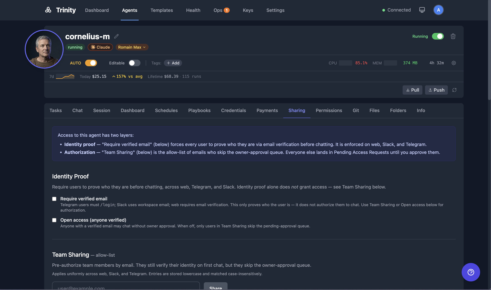

# Cross-Channel Access Control

Unified access control across all channels (web, Telegram, Slack). Verified email is the identity — approving a user once admits them everywhere.

## Concepts

| Term | Description |
|------|-------------|
| **Verified email** | Email proven via verification code (Telegram `/login`) or OAuth (Slack workspace) |
| **Access policy** | Per-agent settings: require_email, open_access, group_auth_mode |
| **Access request** | Pending approval when a verified user contacts a restricted agent |

## How It Works



### Email Verification

Verification is not a separate switch on the Channels tab. Both positions of the **Restricted ↔ Open** control (below) require a verified email — the control writes `require_email: true` every time — so users verify before chatting either way. Turning verification off entirely (`require_email: false`) is only possible through the access-policy API.

### Fleet-Wide Default for New Agents

Admins can set the default `require_email` policy that newly created agents start with:

1. Go to **Settings → General**.
2. Toggle **Require verified email for new agents**.

This default is **on** out of the box (secure-by-default). It applies at agent-creation time only — existing agents are never rewritten, and owners can still override the setting per agent in the agent's Channels tab.

| Endpoint | Method | Description |
|----------|--------|-------------|
| `/api/settings/agent-defaults/access-policy` | GET | Current fleet-wide default (admin-only) |
| `/api/settings/agent-defaults/access-policy` | PUT | Update the default for new agents (admin-only) |

### Channel-Specific Verification

| Channel | How Email is Verified |
|---------|----------------------|
| **Telegram** | User sends `/login your@email.com`, receives 6-digit code, replies `/login 123456` |
| **Slack** | Automatic — workspace OAuth provides the email |
| **WhatsApp** | User sends `/login your@email.com`, receives a code, replies to verify |
| **Web (public links)** | Email verification during public chat session |
| **Workspace** | A 6-digit code emailed at sign-in — see [Workspace](workspace.md) |

### Access Modes

The Channels tab presents this as a single **Restricted ↔ Open** switch under "Who can chat with this agent?":

**🔒 Restricted (default)**: Only owner, admins, and explicitly approved users can chat. Others see "Your access request is pending approval."

**🌐 Open**: Any user with a verified email can chat immediately.

### Approving Access Requests

When someone requests access:

1. Their request appears in the **Channels** tab as a "Pending requests" list under the Restricted/Open switch.
2. Click **Approve** to grant access (adds them to the share list).
3. Click **Deny** to reject.

**Each request names who asked, as the channel saw them.** A request leads with the person's name or handle, then the channel and the person's id on it (for example *Telegram id 123456789*), their verified email, and when they asked. Telegram supplies the `@username` and first and last name; WhatsApp supplies the profile name; a field the channel does not expose stays empty. Up to three **seen before** badges show where the same channel identity has turned up on other agents you manage: **Approved**, **Denied**, **Asked** or **Verified** on *agent-name*, with a **+N more** badge for the rest. Two other badges mark a request with less to go on: **Email only — public link** (a public link carries a verified email and nothing else) and **Identity not captured** (a request made before Trinity recorded identities). When someone asks again, the request shows their current identity; your decision does not erase it.

Approving auto-adds the email to your shared users list, which also puts the agent on that person's [Workspace](workspace.md) roster. It does not create a platform account or add the email to the login whitelist.

**The requester is notified automatically.** When you approve a request that came in over Telegram, Slack, or WhatsApp, Trinity sends the requester a message on that same channel confirming they now have access — closing the loop on the "I'll let you know once the owner responds" reply they got when they first messaged. Web users see the change through the dashboard. Denials are silent (the agent's existence is not confirmed to the requester). A delivery failure (e.g. the user blocked the bot) never blocks or rolls back the approval; the outcome is recorded in the audit log.

## Group Chat Authentication

For Telegram groups, you can require at least one verified member before the bot responds:

1. Set **Group auth mode** to `any_verified` via API.
2. When someone @mentions the bot in an unverified group, the bot prompts for verification.
3. Once one member verifies via `/login`, the group is unlocked for everyone.

## Telegram Commands

| Command | Description |
|---------|-------------|
| `/login email@example.com` | Start email verification |
| `/login 123456` | Complete verification with code |
| `/logout` | Remove verified email |
| `/whoami` | Check current verification status |

## For Agents

### Access Policy API

| Endpoint | Method | Description |
|----------|--------|-------------|
| `/api/agents/{name}/access-policy` | GET | Get current policy |
| `/api/agents/{name}/access-policy` | PUT | Update policy |
| `/api/agents/{name}/access-requests` | GET | List pending requests, each with the requester's channel identity (`requester_*` fields), `identity_captured` and `known_as` (the same identity on other agents you manage) |
| `/api/agents/{name}/access-requests/{id}/decide` | POST | Approve or deny |

**Policy body:**
```json
{
  "require_email": true,
  "open_access": false,
  "group_auth_mode": "none"
}
```

**Decision body:**
```json
{"approve": true}
```

## Limitations

- Group chats with `group_auth_mode: "none"` bypass email verification entirely.
- Slack requires `users:read.email` scope for email resolution.
- A pending `/login` on Telegram or WhatsApp expires after 10 minutes; the user re-sends `/login` with their email to get a new code. If Redis is unavailable the pending code is not kept, and the user has to start again.
- Sign-in code requests are capped over a 10-minute window: 5 per chat sender, 3 per email address and 20 per Telegram bot, WhatsApp number or Slack workspace. Over a cap the bot replies *Too many sign-in code requests. Try again in 10 minutes.* and sends no email. The per-address cap is shared with the web sign-in and MCP email sign-in, so codes requested for one address on any surface count together, and someone who keeps requesting codes for an address can hold back that address's codes for the window.

## See Also

- [Agent Sharing](agent-sharing.md) — Manual sharing with specific users
- [Telegram Integration](../integrations/telegram-integration.md) — Telegram bot setup
- [Slack Integration](../integrations/slack-integration.md) — Slack workspace connection
- [Workspace](workspace.md) — the signed-in chat app for the people an agent is shared with
