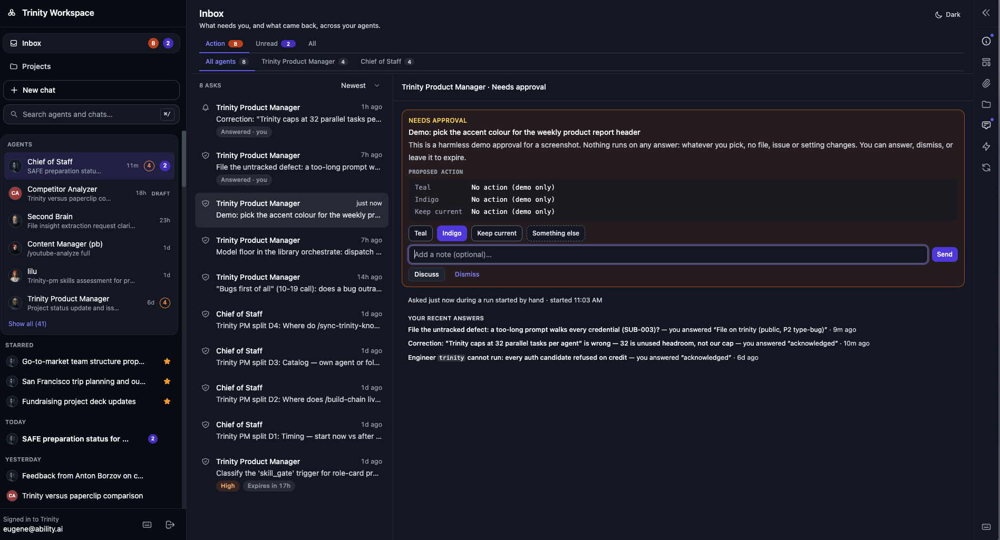
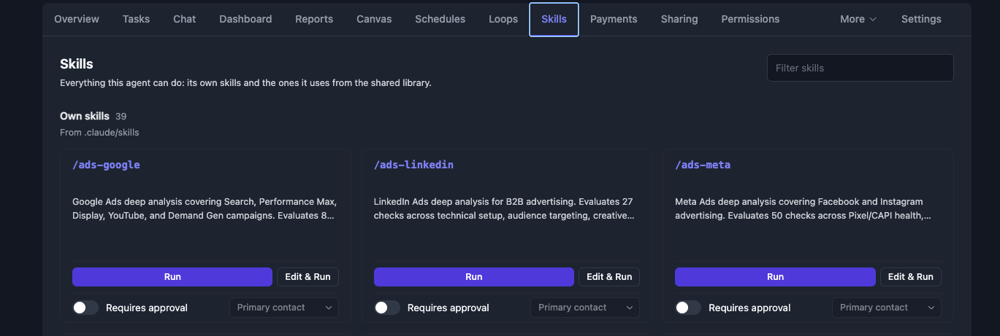
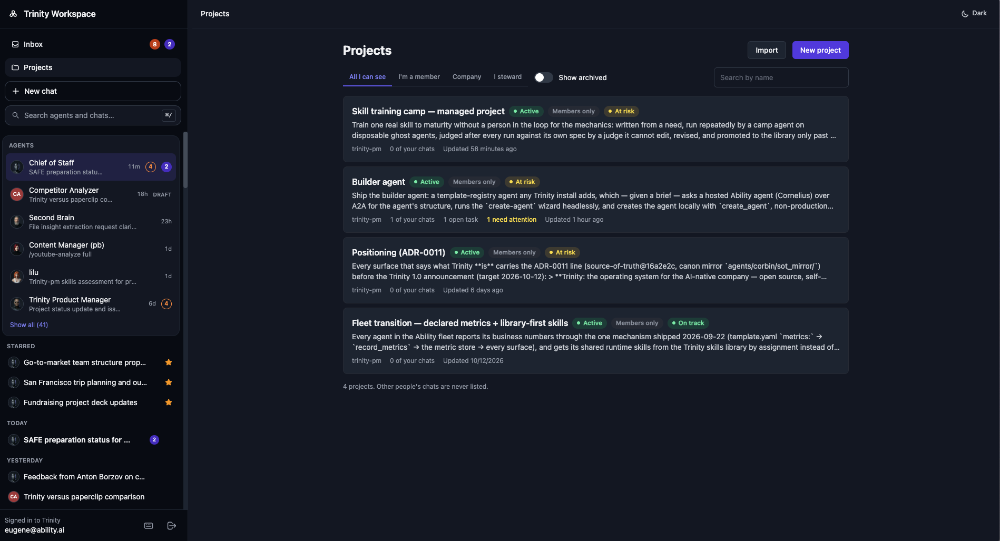
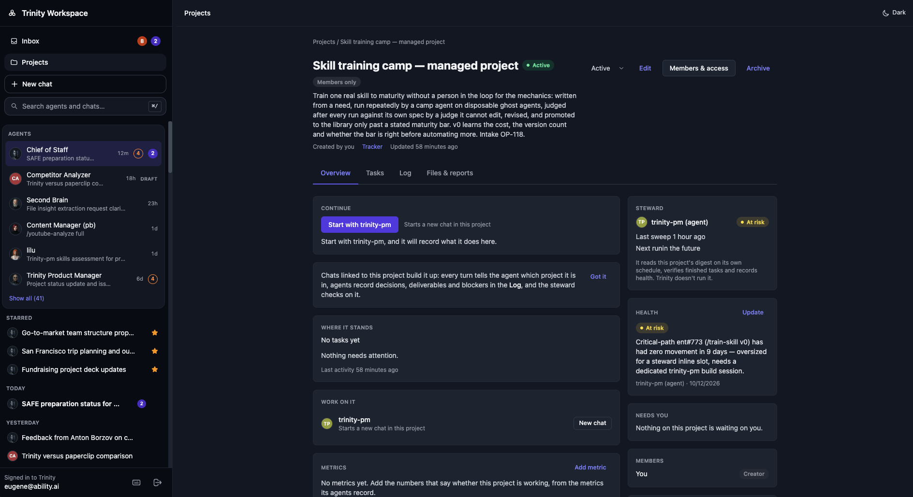
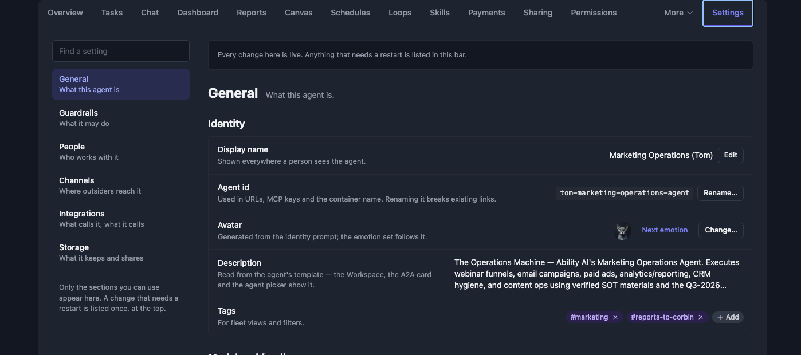
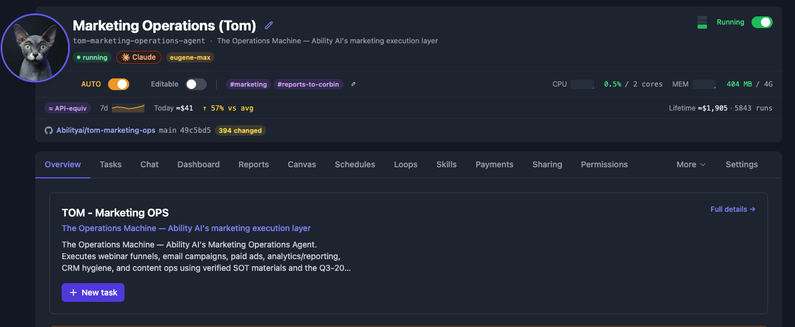
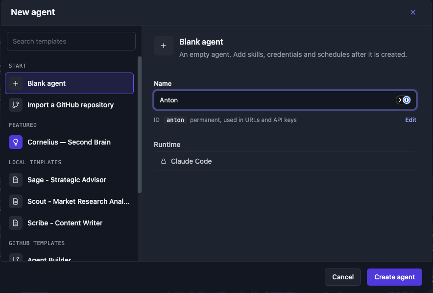
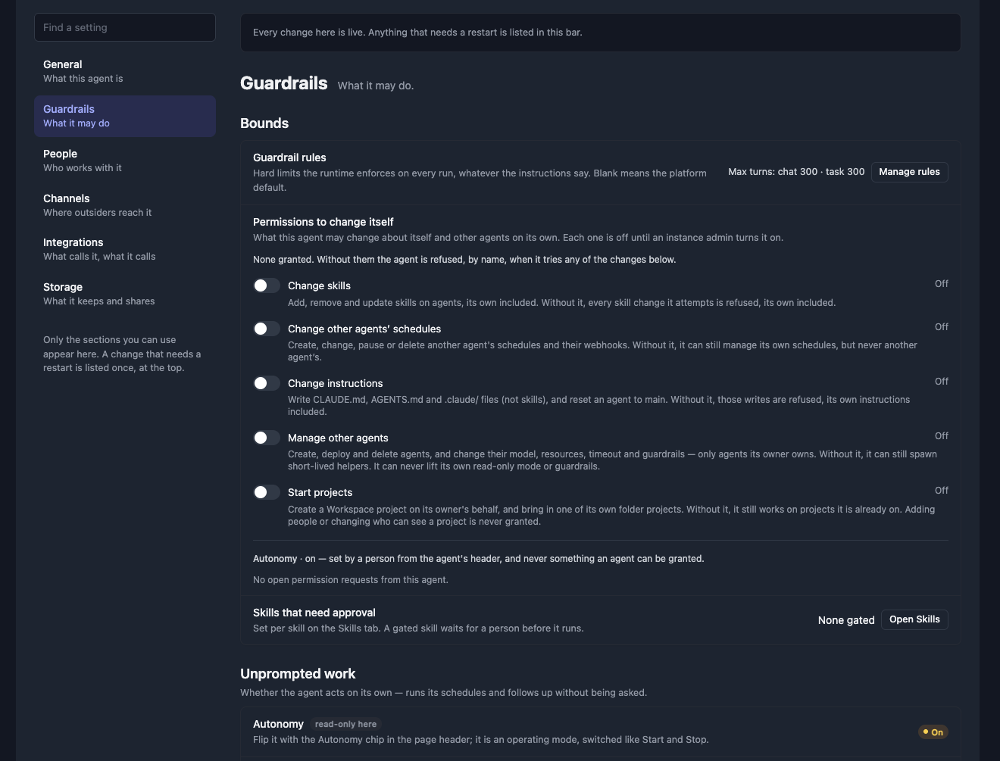
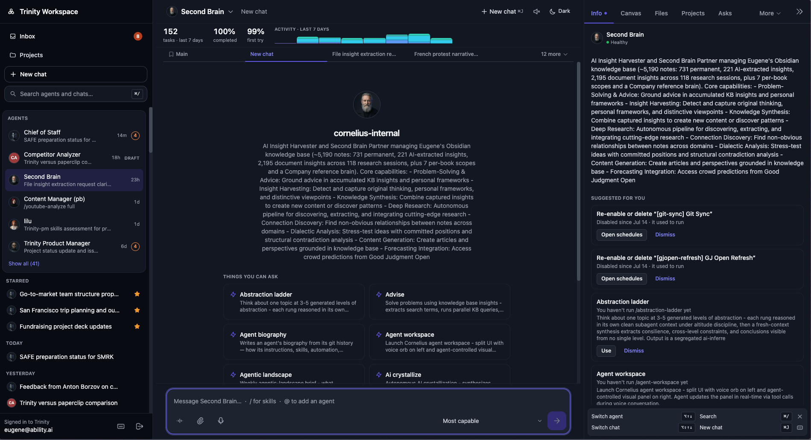

# What's New in Trinity v1.0.0

*Released 2026-10 · 384 merged changes since v0.9.5*

v0.9.5 made Workspace the place where the work happens. **v1.0.0 makes the agents accountable to the people they work for.** An agent now knows who it serves and which business numbers it owns. When it needs a decision, the question lands in one **Inbox**, and a skill you marked for approval waits until a person approves it. Longer efforts live in **Projects** that an agent can start, continue and report on. Around that, agents stay inside clear limits: they change themselves only with a grant, reach only the agents they may call, and run another agent's library skills only when granted. The agent page has one **Settings** home, git sync now pulls as well as pushes, and Trinity installs from the AWS and Vultr marketplaces.

## Improvements

### One Inbox for everything that needs you

The Workspace sidebar opens with **Inbox**, **Projects**, **New chat** and **Search**. The Inbox gathers what needs you across every agent: **Action** for what waits on your answer, **Unread** for what came back, and **All**. Sort Action by **Newest** or switch to **Urgency**, and read each item in a pane beside the list.

- **Answer an ask your way.** Pick one of the agent's options, choose **Something else** and write your own, **Discuss** it in a chat that stays linked to the ask, or **Dismiss** it.
- **Asks stay where they were raised.** An ask raised during a chat turn is attached to that chat, and **Open in chat** takes you back to it. Each agent's rail has an **Asks** tab with its open and recently ended asks.
- **Agents tidy up after themselves.** An agent sees its own pending asks, can replace one with a better question, and can withdraw one that no longer matters. A withdrawn ask shows in the history with the agent's reason.
- **Tag a person.** Tagging someone in a conversation puts it in their Inbox.
- **Address a role, not a name.** Agents send asks, reports and messages to a role such as the primary contact, and Trinity works out who fills it.

See [Approvals](../automation/approvals.md) and [Workspace](../sharing-and-access/workspace.md#the-inbox).

### Skills that wait for a person

Mark any skill **Requires approval** and pick who approves: the primary contact, an approver, or a role from the agent's roster. Trinity checks the approval before the agent ever sees the request, and checks again inside the agent, so a gated skill cannot run on its own.

- **An approval card that says what is being approved.** The approver sees which agent, which skill, the exact input, and who asked. Approve or reject in one click, with an optional reason.
- **The requester hears back.** The person who asked sees how the request ended, quoted in their conversation.
- **Approvers who can act.** An approval goes only to people who can open the agent, and the picker marks a choice that has nobody to send it to.

The agent page also has **one Skills tab**: the agent's own skills and the ones it uses from the library, each with **Run**, **Edit & Run** and the approval controls.

 **Skill sets** let an admin assign a named slice of the library to an agent in one step. See [Skills and Playbooks](../automation/skills-and-playbooks.md#requiring-approval-for-a-skill).

### Projects

On instances with the entitlement, **Projects** holds work that outlasts a chat. Each project has a goal written in markdown, an **Overview** with a **Continue** card that starts the next chat in the project, and **Tasks**, **Log** and **Files & reports** tabs. Chats linked to a project tell the agent which project it is in, and agents record decisions, deliverables and blockers in the Log. A **Steward** agent checks on the project on its own schedule and records its health. An agent can also start or import a project for its owner when an admin allows it. See [Workspace Projects](../sharing-and-access/workspace-projects.md).

### Agents with a role and a number to move

- **Who an agent serves.** An agent has a primary contact and seats for the other people around it. Workspace shows each person a **role card**: what the agent does for them, its objectives in plain words, and how fresh its numbers are.
- **Business metrics.** A template declares the metrics its agent reports. The agent records values with `record_metrics`, dashboard tiles and widgets show them, and objectives compare target with actual. A corrected value restates its point instead of adding a second one.
- **Ready when you say so.** A new companion's proactive briefs are held while it is still being calibrated, until its owner marks it ready. The agents list and the Grid show a readiness stamp.
- **A record of decisions.** Workspace keeps why something was approved, deferred or stopped.
- **Schedules that act for a person.** A schedule can name a user, and its run reads and writes that person's memory.

See [Dynamic Dashboards](../advanced/dynamic-dashboards.md) and [Workspace](../sharing-and-access/workspace.md#the-role-card).

### One Settings home for each agent

The agent page has one **Settings** tab, pinned at the end. A left rail splits it into **General**, **Guardrails**, **People**, **Channels**, **Integrations** and **Storage**, with a **Find a setting** box at the top. Changes that need a restart are listed in one banner with a single **Restart** button. The Info, Credentials, Access and Folders tabs moved into these panes, and old links to them still open the right pane. The Git tab gains **Pull**, **Push** and **Refresh**.

The agent header puts the day-to-day facts in one place. Edit the name in place with the pencil, and hover the avatar to change it. Next to the name are the runtime and the subscription that pays for the agent's runs. Below them are the Autonomy and read-only switches, tags, and live CPU and memory. The header also shows a 7-day spend sparkline with today's spend against the average, lifetime spend and run count, the linked GitHub repository with its branch and uncommitted changes, and capacity bars that light up while the agent runs.

Creating an agent is simpler too. The **New agent** dialog is a two-pane picker: choose a source on the left, then name the agent on the right and see its final ID before you create it. See [Agent Configuration](../agents/agent-configuration.md), [Managing Agents](../agents/managing-agents.md) and [Creating Agents](../agents/creating-agents.md).

### Agents stay inside clear limits

- **Change itself only with a grant.** An admin grants each agent the specific changes it may make on its own: its skills, other agents' schedules, its instructions, other agents, and projects. Each grant is a toggle under **Settings → Guardrails**, and every grant and refusal is audited.
- **Reach only the agents it may call.** An agent's own key sees itself, the agents it is permitted to call and the agents it spawned. That now holds on fleet-wide lists too.
- **Skills across agents need a grant.** Permission to call another agent covers the skills that agent declares itself. Running a skill it got from the library needs a grant for that skill.
- **A file rule per action.** The Files tab follows one rule for who may read, write and delete each kind of file. Credential files are readable only by the owner, and an agent's instructions are changed only by the owner or a key with the matching grant.
- **Workspace-only users.** The platform role `user` now signs in to Workspace only, and sharing an agent no longer creates a login.

See [Agent Permissions](../collaboration/agent-permissions.md) and [Agent Files](../agents/agent-files.md#who-can-do-what).

### Git sync that pulls

An agent with auto-sync now fetches and rebases from its remote on its own, not only pushes, and merge conflicts are recorded as conflicts. Sync health appears on the agent card and on fleet health, and a branch that has diverged for more than a day turns red. See [GitHub Sync](../integrations/github-sync.md).

### Agent-to-agent across instances

Outbound A2A calls are part of every edition. An agent can call a paid A2A agent that asks for payment, and an inbound agent can charge for calls and show its price on its card. Every inbound call now needs a credential. A signed agent identity for calls between Trinity instances ships switched off; an admin turns it on under **Settings → Integrations**. See [A2A Protocol](../integrations/a2a-protocol.md).

### Install from the AWS and Vultr marketplaces

Trinity runs from an AWS machine image or a CloudFormation stack, and on AWS the first admin claims the instance with its instance ID. Trinity is also listed as a Vultr marketplace app. One-click installs now ship with a bundled PostgreSQL. See [Deploy on AWS](../guides/deploying/aws.md) and [Deploying Trinity](../guides/deploying-trinity.md).

### Suggestions in Workspace

A new chat opens with **Things you can ask**: the agent's skills, each one a click away. The Info tab adds **Suggested for you**: skills you have not tried yet and schedules that stopped running. Use one or dismiss it.

### More improvements

- **Workspace.**
  - Opening an agent starts a new chat with the cursor in the message field, and your unsent text survives switching agents, chats and rooms.
  - Reply to a specific message from inside the chat.
  - A keyboard map moves between agents, chats and the rail from the message field; ⌘/ jumps to search.
  - Chat tabs hold still while you are on them, show unread counts, and close from the tab.
  - Remove an attachment before sending with the × on its chip.
- **Telegram groups.** When an agent is tagged in a group, it knows the group's recent conversation.
- **Delegation reports back.** Work an agent hands to another agent from Slack, Telegram or Workspace posts its outcome back into that conversation. A receipt now means the work is running, so callers do not re-send.
- **Send once.** Messages, group messages and calls to people accept an idempotency key, so a recurring agent does not repeat what it already said.
- **Agents know their environment.** The platform prompt tells each agent what it runs on and what it can reach.
- **Skills library.** Admin keys can manage library sources over MCP, and the bundled community catalog moves to v0.5.0.
- **Retention.** Metric points have their own retention rows under **Settings → Retention**.

## Fixes

- **Workspace** — Each turn shows its own reply, even when the same chat is open in two tabs, and a sent message keeps its attachments after a reload.
- **Workspace** — The chat's Working clock shows the turn's real age when you rejoin, and the live work card keeps one steady shape instead of jumping or showing a contradictory "steps could not be read" line.
- **Workspace** — Chat tabs keep a fallback title when none can be generated, star on the first click, and Esc cancels a rename instead of saving it.
- **Workspace** — A chat or agent link you cannot open no longer offers a composer, and the new-chat state shows correctly after a Reset.
- **Workspace** — Long words wrap inside their bubble, the composer warns about the message limit before you send, the sidebar loads without shifting, success rates read as percentages, and canvas tables render inline formatting.
- **Approvals and asks** — An ask sent to a role that several people fill now reaches every one of them, and agent-written markdown renders properly in asks.
- **Approvals and asks** — Pending approvals stay in sync with the agent's own copy, so an entry the agent changed or closed is no longer left waiting unseen. An approval that expired without the platform holding the action is marked as having an unknown outcome rather than a plain timeout.
- **Approvals and asks** — Platform alerts no longer pile up: each problem keeps a single pending entry, acknowledging an alert ends it, and the overload alert no longer floods the queue on its own.
- **Approvals and asks** — A held request stays in its conversation and is raised once, and a capped list of pending asks keeps the longest-waiting ones.
- **Agents and templates** — Creating an agent works on small hosts, because CPU limits are capped at what the machine has.
- **Agents and templates** — Public GitHub templates install even when the saved GitHub token is stale or rate-limited, and your own repository is no longer mistaken for a shared catalog template.
- **Agents and templates** — A fresh install seeds all its starter agents again, and its first agents no longer open with false "must-fix" warnings.
- **Agents and templates** — Skills report their real state: a deprecated or non-invocable library skill says so, the "shadowed" badge names its sources, an agent's own skill is never overwritten by a library skill of the same name, and skill-delivery failures show up when an agent starts.
- **Chat and MCP** — Long-running chat no longer picks up a scheduled run's conversation, and every Chat tab message is sent once.
- **Chat and MCP** — Work delegated with `chat_with_agent` reports back into the conversation that asked for it, and the system agent can now publish its reports and canvas.
- **Chat and MCP** — Errors read as what they are: an invalid model is reported as invalid instead of as an outage, a usage limit is not reported as "agent busy", and a model the CLI refuses is no longer treated as a sign-in failure.
- **Chat and MCP** — Claude Opus 5.5 is selectable everywhere, Gemini agents run turns again, and Codex failures are classified correctly.
- **Chat and MCP** — When a subscription is rate-limited, a turn tries every other subscription and then the platform API key before it gives up.
- **Channels** — Long Telegram replies arrive complete, long agent replies land in rooms instead of disappearing, and public chat visitors keep their history across a reload and see a plain-language message when a turn fails.
- **Channels** — Long A2A turns survive the caller's timeout, and paid agents on card plans can now be paid.
- **Channels** — Webhook and MCP addresses use https when Trinity sits behind an HTTPS proxy, and public links show a full, copyable address.
- **Scheduling and execution** — Run records are honest: a turn recovered after a backend restart is completed instead of failed, and it records the agent's real finish time.
- **Scheduling and execution** — Schedule validation judges the run it was given, and an empty result is reported as "validation unavailable" rather than a failed run.
- **Scheduling and execution** — Busy multi-worker installs admit runs reliably, a loop interrupted mid-step is repaired, and a failed background run stops replaying its old receipt.
- **Git sync** — Auto-sync fetches and rebases before it pushes, its on/off switch takes effect immediately, push access is checked where GitHub enforces it, and ahead/behind counts measure the agent's own branch.
- **Git sync** — Forking and binding a repository use your saved personal GitHub token, new repositories start in the right folder, git status shows full file paths, and an agent with no repository stops raising remote-check alerts.
- **Sign-in and setup** — The system agent is deployed as soon as setup creates the admin, the sign-in page says so when no email provider is configured, and the email whitelist validates entries and can remove any row.
- **Settings** — Settings loads cleanly, a tab survives a refresh, the Retention tab shows backup status, and Gemini keys in the newer format are accepted.
- **Deployment** — The DigitalOcean installer installs the right release and no longer asks for a Claude token up front, and sending email can no longer stall the server.
- **Operations** — The Health tab reaches every alert and shows a dormant breaker, the pending-notification count no longer follows the list filter, new agents appear on the dashboard at once, and dashboard tiles read their own data.

## Security & Hardening

- An agent's own key reaches only itself, the agents it is permitted to call and the agents it spawned, on every route and on fleet-wide lists.
- Withdrawing a permission between agents also withdraws shared-folder access and event delivery.
- Agents can no longer read their own credential files through the Files surface, and file access rules apply consistently to every path spelling and to deletes.
- Guardrail hooks run in an isolated, read-only configuration that an agent cannot alter or route around, and an agent's health check reports if they go missing.
- Creating or listing MCP keys, and changing agent configuration or your own identity, require a signed-in person, not an agent key.
- Changing a sign-in email requires a code sent to the new address, and each address belongs to one account.
- Workspace clients see only their own runs on an agent's page, never another person's timings or any run costs.
- Event payloads passed into an agent's prompt are framed, size-limited and scrubbed of credentials, and event history only shows agents you can access.
- A chain of agents calling agents is limited in depth, so runaway delegation stops.
- A room checks every participant's access again each time it wakes its agents, so someone who has lost access to an agent can no longer reach it through a room.
- A suspended account loses the live event stream as well as the API.
- An A2A caller can read or cancel only its own tasks.

## Upgrade Notes

- **Rebuild or pull the platform images, then rebuild the agent base image and recreate agents.** Agents on an older image keep working, but the in-container approval check and the protected write-back of asks take effect only on the 1.0 image. Until then the Skills tab shows a gated skill as not enforced. See [Upgrading](../guides/deploying/upgrading.md).
- **Hosted compose now defaults to the bundled PostgreSQL.** `start.sh --hosted` keeps an existing SQLite install on SQLite. If you run `docker-compose.hosted.yml` directly and your data is in `trinity.db`, add `DATABASE_URL=` (empty) to `.env` before upgrading, or migrate first. `POSTGRES_PASSWORD` is now required. See [SQLite to PostgreSQL](../../migrations/SQLITE_TO_POSTGRES.md).
- **The PostgreSQL role must be allowed to create the `pg_trgm` extension**, which the execution search indexes use.
- **The platform role `user` is Workspace-only.** People with that role lose the operator UI. See [Workspace-only user role](../../migrations/WORKSPACE_ONLY_USER_ROLE_2026-10.md).
- **Agents can no longer change skills by default.** An admin grants **Change skills** per agent under **Settings → Guardrails**.
- **An agent can no longer run another agent's library skills by default.** A permission between agents covers the skills the target declares itself; a library skill needs a grant per skill. **Settings → Agents** lists the calls from the last 30 days that are now refused, each with a **Grant** button.
- **Every inbound A2A call needs a credential.** The keyless path for private networks is gone; the trusted-network list now only limits where your agents may call out to.
- **Delegated work reports back.** Turn it off with `MCP_REPORT_BACK_ENABLED=false`.
- **Telegram group context is on for existing groups.** Where the bot can read all group messages, untagged messages are kept and recent history is given to the agent when it is tagged. Turn it off per group in the agent's Telegram panel.
- **Pull sync starts on auto-syncing agents.** Agents with auto-sync on now also fetch and rebase on a timer.
- **New default limits.** Agent-to-agent chain depth 8, event-triggered runs 120 per hour per agent pair, pending asks marked as aging after 24 hours, and metric points kept 365 days with 100,000 per agent per day. Change them with `PUT /api/settings/ops/config`.
- **Settings housekeeping.** New installs pin the community skills catalog to `v0.5.0`; existing installs keep their pin until an admin re-points the source. Enterprise instances bump the enterprise submodule pin to the release's commit.
- **Re-login** after upgrading and **reconnect** MCP clients.

## Known Limitations

- **Approvals have a single approver.** Approval chains and edit-before-approve are not in 1.0.
- **Self-change permissions** govern the changes an agent makes through the platform. Edits an agent makes to its own files inside its container are not gated.
- **Signed agent identity between instances ships switched off.** Cross-instance A2A uses keys unless an admin turns it on; acting for a person and calling outside resources are prototypes behind a second switch.
- **Pull dispatch is an opt-in pilot** per agent. Push remains the default.
- **Sharing an agent gives that person full access to its working files.** Share only with people you trust.
- **DigitalOcean 1-Click** can be deployed on plans below the 4 GB / 2 vCPU minimum. Choose at least that size.
- **Workspace.** A background run's card in the Work panel cuts off long outcomes, and **Bind to this repo** stays disabled while the saved personal GitHub token is in use; bind through the API meanwhile.

## See Also

- [Workspace](../sharing-and-access/workspace.md) and [Workspace Projects](../sharing-and-access/workspace-projects.md)
- [Approvals](../automation/approvals.md) and [Skills and Playbooks](../automation/skills-and-playbooks.md)
- [Agent Configuration](../agents/agent-configuration.md) and [Agent Permissions](../collaboration/agent-permissions.md)
- [GitHub Sync](../integrations/github-sync.md) and [A2A Protocol](../integrations/a2a-protocol.md)
- [Deploy on AWS](../guides/deploying/aws.md) and [Upgrading](../guides/deploying/upgrading.md)
- [v1.0.0 release notes](../../releases/1.0.0.md) — the complete technical record
